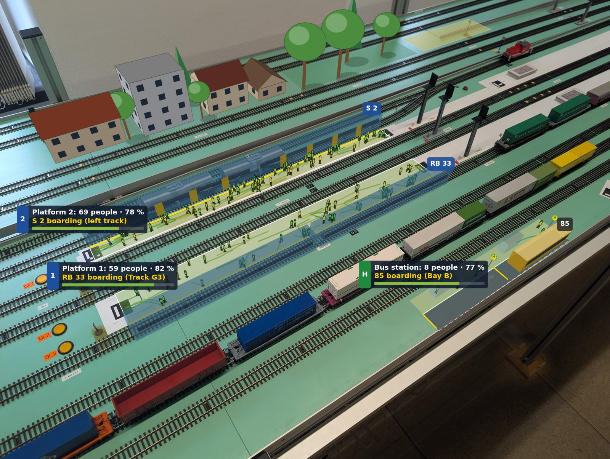
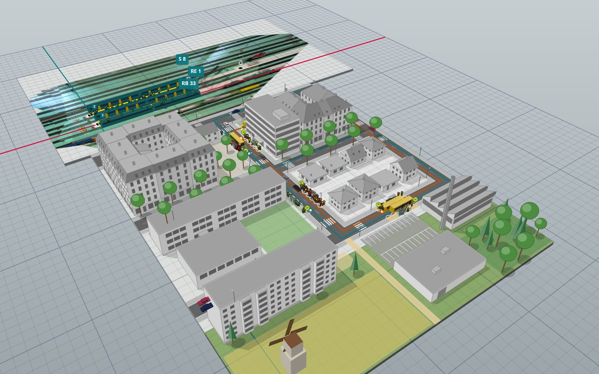

# ARail-EBL

**Augmented reality for model railway laboratories.** Point a phone, tablet or webcam at a model railway layout: ARail puts platforms full of passengers, a small town with streets, trams and bus lines and a container terminal on it, runs the town through day and night, tells a train breaking down, the maintenance of the railway's infrastructure and a traveller's journey as stories to click through, simulates disruptions, and shows the trains your control system reports. A flyover lets you look at and build the layout with a virtual camera. The app is an interactive presentation; its games and exercises (asset management of the infrastructure, a railway undertaking with its fleet, workshop and crews, journeys with transfers that the attendees plan themselves) are on the game page beside it, with the first of the role games: the signaller of Bf Neustadt in a relay interlocking. It runs in the browser, needs no installation and no calibration board.

[**Open the app**](https://joernmht.github.io/ARail-EBL/app/) · [Game page](https://joernmht.github.io/ARail-EBL/game/) · [Signaller game](https://joernmht.github.io/ARail-EBL/game/signaller/) · [Project page](https://joernmht.github.io/ARail-EBL/) · [Print markers](https://joernmht.github.io/ARail-EBL/markers/) · [Documentation](docs/README.md)



*A photo of the railway operations lab (EBL) layout, augmented by ARail: the virtual objects are registered on the real H0 table from the printed markers alone. At the front right, a virtual table module with a street extends the table.*

ARail-EBL started as a prototype for the railway operations laboratory (EBL) and is meant for other railway labs, model railway clubs and teaching as well. The passenger and town simulations are examples; the framework is built so that you can add your own objects, simulations and disruption types.

## What it does

| | |
| --- | --- |
| **Platforms with passengers** | A platform between two markers. Passengers arrive, wait at the edge where their train stops, board and alight through the doors; their colour shows their mood. |
| **A town, day and night** | German house types in the greys of an architectural model: Plattenbau (WBS 70, QP 61, P2), Gründerzeit blocks, single-family houses and estates, school, supermarket, office, workshop, a modern station building with a pedestrian underpass; trees, forests, fields, water, labels. A fast clock (1:12) drives the lighting, the timetables and the residents, who go to work, school and shopping on foot, by bus and by train; at night windows and street lamps light up. |
| **Streets, trams and buses** | Streets form a road network, each with a cross-section by the German guidelines (RASt 06, ERA 2010): car lanes, sidewalks, bike lanes or bike paths, tram tracks and parking, with standard widths to choose. Bus and tram stops (step-free or not), bus terminals and bus and tram lines, back and forth or as a ring (*Ring ↻*, *Ring ↺*); trams on single tracks, turning in loops or at stub tracks, with traffic lights where people cross the street to them. Cars with drivers and passengers that park and pay, bikes and e-scooters, traffic signs, traffic lights, zebra crossings, and railway crossings over, under or at street level. |
| **Photo tour and flyover** | Walk round the lab from photo to photo, as in Street View: arrows to the next part of the table, buttons for the side it is seen from (front, back and the diagonals); a photo with a digital layer opens with its layout. A virtual camera (key `F`) to look at and edit the layout without the camera image: a snapping grid, one solid orthophoto of the linked parts of the real table, and virtual table modules that extend the tabletop. |
| **Container terminal** | Container trains, trucks and barges at a terminal with a gantry crane, a reach stacker and yard blocks. Choose a container and its new place in the Terminal panel or on the stage; the crane does the move. Model wagons on the real layout carry printed deck cards with AprilTag tags (a marker family of their own), so their containers ride on them. |
| **Rail operations** | In the app, an **operations story** to click through on Bf Neustadt: RB 31 to Talsee breaks down at the platform, the operations control sends the spare unit from the depot, the passengers change trains, the broken unit runs empty to the workshop; what it costs under the transport contract. On the game page, the railway undertaking as a game: units with maintenance cycles and failures that grow with age and wear, a depot workshop, and the four functions of the entity in charge of maintenance (ECM), each with a party of its own; penalties between the transport authority, the railway undertaking, the ECM and the workshop. Drivers with contracts, duties under the working-time rules and a roster, who live in the town and walk to the depot, or come in by train. Compare setups (integrated or distributed maintenance, crew buffers) under stress tests: a flu wave, a staff shortage, a heat wave. |
| **Journeys** | In the app, a **traveller's story** to click through on Bf Neustadt: Ada walks to platform 1, her RB 31 is 20 minutes late and her connection in Talsee lost, her travel app finds a bus from the bus station, which takes her while the late train comes in without her; then her journey in numbers and her rights as a passenger (refunds from 60 minutes late, the transport association's mobility guarantee). On the game page, an exercise for the lab: instead of a town full of generated people, every attendee makes one traveller with a start and an aim (a house, the school, a station beyond the layout) and chooses a travel plan with transfers: walks, buses and trains with the time for each change. The travellers follow their plans on the layout, take the next train when they miss theirs or it is cancelled, and the results compare planned and real arrivals. |
| **Infrastructure** | In the app, a **maintenance story** to click through on Bf Neustadt: exit signal N2 fails, track G2 is closed, the repair team drives out from the maintenance base, repairs the signal and exchanges it; then track G3 is renewed with a construction train. Back, Next, Play, a presenter's clicker, and the flyover's camera following the story. On the game page, **asset management as a game**: the station on the layout as part of an invented district with two lines: track, switches, signals, balises, interlockings, level crossings, cables, GSM-R, overhead lines, platforms, lifts and displays, each with its condition (grades 1–6), faults and an age. How well a condition is known depends on the asset: a digital interlocking reports it live, a relay interlocking only shows faults, old signals must be inspected. Maintenance staff in shifts, emergency vans that drive through the town, drones; renewals and upgrades through the HOAI phases with federal funding (benefit-cost ratio), planning approval, tenders and a level crossing plant. Students play the asset manager, the ALVs, the dispatcher, the planner, the construction supervision and the funding authority, year by year with limited money and people. Assets are coloured on the photo by their condition and last check; a line map and GeoJSON for GIS. |
| **Lab survey** | Stickers all over the table, one video: `arail-survey` measures every marker and writes a fixed, locked layout, a report and an orthophoto of the table; in the app, *Build → Marker map → Survey a video* gives a quick check. Markers on vehicles can be set as moving; they stay out of the map. |
| **Disruptions and scenarios** | Delays, cancellations, closures, signal failures, crowd surges, rail replacement buses; scripted scenarios for exercises. |
| **Control-system interface** | A Python bridge forwards real train positions over WebSocket. When a real train stops at a platform, the virtual passengers board it. |
| **Extensible** | Plugins (plain ES modules) add object types, simulations, disruption types and vehicles. Settings forms are generated automatically. |



*The example layout in the flyover: a town on eight virtual table modules in front of the real lab table, which shows its orthophoto.*

Under the hood: square markers ([ArUco or AprilTag](docs/lab-setup.md#markers)) lie flat on the layout. From the images alone, ARail surveys where the markers are, computes the camera pose from all visible markers and estimates the camera's focal length. On the lab photo at the top, the estimated focal length (1110 px) agrees with the value derived from the photo's metadata (1111 px), and the platforms come out at 700.7 mm and 718.4 mm, in line with the prototype's earlier measurement of about 700 and 720 mm.

## Quick start

**Try it:** open the [app](https://joernmht.github.io/ARail-EBL/app/). It starts with a photo of Bf Neustadt, the part of the lab table surveyed on 9 October 2026. Use the tabs on the right to add objects (Build), switch modules on and off (Overview → Modules), and set the simulation, the time of day and the control system (Settings). Switch on the module **Operations** for the operations story (Operations tab), **Infrastructure** for the maintenance story (Infrastructure tab) or **Journeys** for a traveller's story (Journeys tab): **Next**, **Back**, **Play**; **Camera follows** flies along. Walk round the lab as in Street View: the arrows at the edges of the stage (or ← and →) go from photo to photo to the next part of the table, the buttons in its upper left corner choose the side, up to six per part (front, back and the diagonals); where a photo has a digital layer, its layout opens with it. **Settings → View → Examples** has more examples from the lab: the container terminal at the lab's crane (move a container: choose it, then its new place), a clip of the station, the hybrid container train, real wagons with AprilTag labels that carry virtual containers, and the first example, Beta 0.1 (see [Getting started](docs/getting-started.md#the-examples)). Press **F** (or **Flyover**) to fly over the layout with a virtual camera, and **Settings → Night 22:30** to see it at night. The [game page](https://joernmht.github.io/ARail-EBL/game/) opens the lab example Beta 0.1 with its games: switch on its modules for the infrastructure game (roles, decisions, budget years), the railway undertaking (**Rail operations**, Operations tab) and the journeys exercise; **Disruptions** (every layout) starts disruptions and scenarios on both pages. The **[builder](https://joernmht.github.io/ARail-EBL/builder/)** edits a layout as a plan: streets that join, with the cross-section and widths you choose, bus and tram stops, parking, truck lanes and buildings at a street, a check that everything has a street to it, and a push of the layout and covered photos to GitHub ([The builder](docs/world-builder.md)).

**On your own layout:**

1. Print markers from the [marker sheet page](https://joernmht.github.io/ARail-EBL/markers/) (ArUco Original, 30 mm) and check the scale with a ruler.
2. Put one marker at each end of every platform and more across the layout, flat and with their white border visible.
3. Open the app, import your own layout or start from an example (**Settings → View → Examples**), then **Take photo** or **Live camera**. Markers the layout does not know yet are surveyed automatically (Build → Marker map → **Measure again** starts with an empty map).
4. In **Build**, add platforms (tap the two markers at its ends), streets, bus stops and lines, buildings and scenery, in the camera view or in the flyover on the grid. **Export layout** saves the result as a JSON file.

For a fixed layout of a whole table, follow the [lab-session guide](docs/lab-session.md): stickers all over the table, one video, `arail-survey`, then build in the flyover. See [Getting started](docs/getting-started.md) and [Setting up a lab](docs/lab-setup.md) for details. The live camera needs https (GitHub Pages) or `localhost`.

**Connect a control system:** `pip install -e "tools[bridge]"` and run the bridge with the built-in simulator, then press **Connect** in the app's **Settings → Control system**:

```bash
arail-bridge --adapter simulator --layout web/layouts/ebl-lab.json
```

Write an adapter for your system from the template; see [Control-system interface](docs/control-system-interface.md).

## Documentation

| Guide | For |
| --- | --- |
| [Getting started](docs/getting-started.md) | Using the app: sources, the flyover, panels, keyboard shortcuts |
| [Setting up a lab](docs/lab-setup.md) | Markers (also on model wagons), printing, placement, cameras, the marker map |
| [Lab session](docs/lab-session.md) | Stickers on the whole layout, one video, `arail-survey`: a fixed layout and an orthophoto |
| [The builder](docs/world-builder.md) | Editing a layout as a plan: streets that join, bus stops, truck lanes and buildings at a street, the street access check with its fixes, covered photos, a push to GitHub |
| [Day and night](docs/day-and-night.md) | The fast clock, lighting, demand over the day, the town simulation |
| [Streets, trams, buses and road traffic](docs/streets-and-buses.md) | The road network and its cross-sections, bus and tram lines, cars and parking, bikes and e-scooters, signs, lights and railway crossings |
| [Container terminal](docs/container-terminal.md) | Trains, trucks, barges, cranes and the yard; deck cards and rolling-stock markers for model wagons |
| [Games](docs/games.md) | A game for every role of the railway system, the game core, the career mode and the big game; the signaller of Bf Neustadt |
| [Roles of the railway](docs/roles.md) | The role catalogue, from the politician to the cleaning staff: decisions, means, limits, risks, ways in and a mini game for each role; the qualifications they need |
| [Rail operations](docs/operations.md) | The operations story of the app (a train breaks down, the spare unit, the workshop, step by step); on the game page: fleet, maintenance (ECM) and penalties, crews and rosters; comparing setups under stress tests |
| [Journeys](docs/journeys.md) | The journeys story of the app (a late train, a lost connection, the bus instead, passenger rights), step by step; on the game page, an exercise: travellers with a start, an aim and a travel plan with transfers, made by the attendees; missed connections and the results |
| [Infrastructure](docs/infrastructure.md) | The maintenance story of the app (a signal exchanged, a track renewed, step by step); on the game page, asset management: assets with their condition and what is known of it, maintenance staff, emergency vans and drones, renewals through the HOAI phases with funding and tenders; roles for students; the asset information model and GIS |
| [Layout file format](docs/layout-format.md) | The JSON file that describes a layout, its modules (layers) and all built-in object types |
| [Languages](docs/languages.md) | The app in English or German (Settings → View → Language, `?lang=de`); adding texts; the glossary of railway terms |
| [Railway systems and trains](docs/rail-systems.md) | Traction power, train protection, signals, radio, gauge and line category of every track; colouring the tracks by them; borders and system changes; vehicles, consists, brake percentage and axle loads of trains; where a train may run |
| [Disruptions and scenarios](docs/disruptions-and-scenarios.md) | Built-in disruptions, their effects, scripting scenarios |
| [Using ARail for research](docs/research.md) | Applying your own model or algorithm to the simulated railway: the ways in, and what you can leave aside |
| [Control-system interface](docs/control-system-interface.md) | Feed protocol, bridge, adapters, https/wss |
| [Extending ARail](docs/extending.md) | Plugins: object types, simulations, disruptions, vehicles |
| [Architecture](docs/architecture.md) | How tracking, the world and rendering fit together; the maths. In UML, with the classes and activities of every model: the [architecture page](https://joernmht.github.io/ARail-EBL/architecture/) |
| [Camera calibration](docs/calibration.md) | Optional calibration for wide-angle webcams |

## Repository layout

```
web/                  the website (published with GitHub Pages)
  index.html          project page
  app/                the AR app (an interactive presentation: the modules as stories to click through), with the
                      flyover and the in-app video survey, in English and German; its shell is the game page's too
  game/               the game page: the games and exercises (infrastructure, rail operations, journeys, the terminal);
                      signaller/ the signaller's role game; roles/ the role catalogue; career/ the career planner
  builder/            the builder: a street and layout editor beside the app, with the street access check and
                      a push of the layout and covered photos to GitHub
  markers/            printable marker sheets and deck cards for model wagons
  impressum/, datenschutz/  legal notice and privacy policy (German)
  arail/              the framework (ES modules, no build step)
    core/             tracking, geometry, world, rendering, clock, road network, bus and tram
                      lines, parking, flyover camera, services, disruptions, scenarios
    objects/          built-in object types (platform, houses, streets and their cross-sections,
                      bus and tram stops and lines, signs, crossings, parking, table modules, ...)
    sims/             simulations: passengers, town (day and night), road traffic, bikes
    terminal/         the container terminal: containers and carriers, yard, cranes, trains, trucks,
                      barges, model wagons from rolling-stock markers
    ops/              rail operations: timetable and rotations, units and failures, maintenance (ECM),
                      contracts and penalties, crews and dispatching, comparisons, the depot
    infra/            infrastructure: asset types and their condition, the network (km, georeference,
                      GeoJSON), staff in shifts, faults and inspections, projects (HOAI, funding,
                      procurement), the level crossing plant, the objects on the layout
    journeys/         journeys: the journeys story; the timetable and the trains at the platforms,
                      the planner of travel plans with transfers, the travellers
    game/             the role games: the game core, the role catalogue's checks, the career model, the signaller's game
    rail/             railway systems of the track sections (power, train protection, signals, radio,
                      gauge, line category, country) and where they change; vehicles and consists;
                      where a train may run
    i18n/             texts in other languages: the translator and the framework's German texts
    feeds/            control-system feeds: WebSocket client, simulated control system
  plugins/            example plugins (windmill object, road traffic simulation)
  layouts/            example layout files (the EBL lab with its modules rail operations, infrastructure,
                      journeys and container terminal; Bf Neustadt with the terminal at the crane, the
                      town at the curve and its modules infrastructure and journeys; the hybrid
                      container train; the container terminal)
  media/              the images and clips of the example layouts and their orthophotos, the project
                      page's video
  assets/             logos, icons and the website's images
  vendor/js-aruco2/   marker detection library (MIT)
tools/                Python tools: control-system bridge, calibration, lab survey, synthetic test scenes;
                      ops-compare.mjs (comparing operations setups from the command line)
tests/                JavaScript (node:test), Python (pytest) and browser (Playwright) tests
docs/                 documentation
examples/             original photo and video of the lab, a recorded control-system feed
```

## Development

Requirements: Node.js 22+, Python 3.10+.

```bash
npm start                                   # serves web/ at http://localhost:8000
pip install -e "tools[headless,bridge,dev]" # Python tools (use [opencv] instead of [headless] on a desktop)
npm run fixtures                            # test images for the JavaScript tests (needs OpenCV)
npm test                                    # JavaScript unit and integration tests
python -m pytest tests/python               # Python tests
npx playwright install chromium && npm run test:e2e   # browser tests
```

See [CONTRIBUTING.md](CONTRIBUTING.md). The original German prototype ("Bahnsteig-AR", Python + browser) is in the git history (commit `ae73015`); its logic lives on in `web/arail`.

## Status

Version 0.1, with unreleased changes on `main` (see [CHANGELOG.md](CHANGELOG.md) and the fragments in [`changes/`](changes/)): the town with its day and night routine, streets and bus lines, the flyover with table modules, the lab survey, the container terminal with rolling-stock markers, rail operations with fleet maintenance and crews, infrastructure asset management as a game for students, journeys with transfers as an exercise, modules to switch, and the app in the chair's corporate design. Tested with a synthetic layout, a photo and a handheld video of the lab. Next: a lab session in the EBL (stickers on the whole table, one video, a fixed layout), live sessions with phones, webcams and a projector, and an adapter for the lab's control system. Known limits: markers smaller than about 20 px in the image are not found; the camera must always see at least one known marker; virtual objects are always drawn in front of real ones (no occlusion).

## License and credits

[Apache License 2.0](LICENSE): free to use, change and share, also commercially. Copies and derived works must keep the [NOTICE](NOTICE) with the credit to Jörn Maurischat and the Chair of Railway Operations, TU Dresden. For cooperation, support or projects with the lab, contact joern.maurischat@tu-dresden.de. The app follows the corporate design of the Chair of Railway Operations (Professur für Bahnverkehr, öffentlicher Stadt- und Regionalverkehr), TU Dresden: Türkis, Noto Sans and the chair's logo. The chair's logo is used with the chair's permission and not covered by the project license; the logo of TU Dresden is not used. The fonts (SIL Open Font License) are self-hosted, so no page loads anything from Google. Marker detection builds on [js-aruco2](https://github.com/damianofalcioni/js-aruco2) (MIT) with dictionaries from OpenCV (BSD-3-Clause) and AprilTag (BSD-2-Clause); see [THIRD_PARTY_NOTICES.md](THIRD_PARTY_NOTICES.md). If you use ARail-EBL in research or teaching, please cite it ([CITATION.cff](CITATION.cff)).
