# Architecture

ARail is a browser application without a build step. The framework (`web/arail/`) is a set of ES modules that also run in Node.js, which is how most of it is tested; it never touches the DOM and is deterministic (seeded random numbers). The app (`web/app/`) is the user interface. Python (`tools/`) provides the control-system bridge, camera calibration, the lab survey and synthetic test scenes.

The whole architecture is also drawn in UML on the **[architecture page](https://joernmht.github.io/ARail-EBL/architecture/)** (`web/architecture/`): the packages and their dependencies, the data flow, and for every model its classes, activity diagrams, settings, events and rules. It is drawn from `web/architecture/model.js` and `web/architecture/models/*.js`, which `tests/js/architecture.test.js` checks against the code; this text is cross-checked by hand whenever the code changes (see [CONTRIBUTING.md](../CONTRIBUTING.md#keeping-the-architecture-page-true)).

## Data flow per frame

The app has two modes. Over the **camera image** the markers in each frame give the camera pose; in the **flyover** a virtual camera gives it, and no video is processed.

<!-- cro-diagram: architecture-01 -->
<picture>
  <source media="(prefers-color-scheme: dark)" srcset="diagrams/architecture-01-dark.svg">
  
</picture>

Diagram source: [architecture-01.mmd](diagrams/architecture-01.mmd)
<!-- /cro-diagram -->

The editor works in both modes through `app.pose()` and `app.eventToLayout()` (a pointer event → a point on the layout, on a raised table module or a bridge where one is: `surfacePoint`), so placing, selecting and dragging are the same on the camera image and in the flyover. Tooltips and info cards (`app/inspect.js`) use the view of the last frame drawn: `World.pick` projects the box of every person and vehicle and finds what is at the pixel, else a layout object (`core/pick.js`).

With rolling-stock markers (`markers.rolling`, model wagons of the [container terminal](container-terminal.md)) the camera mode reads a second marker family in the same pass:

<!-- cro-diagram: architecture-02 -->
<picture>
  <source media="(prefers-color-scheme: dark)" srcset="diagrams/architecture-02-dark.svg">
  
</picture>

Diagram source: [architecture-02.mmd](diagrams/architecture-02.mmd)
<!-- /cro-diagram -->

The tags are lifted with the smoothed pose of the same frame, after `update`, so the wagons and their containers match what the `View` draws. The flyover processes no video: the model wagons keep their last pose there.

## Modules

| Module | Responsibility |
| --- | --- |
| `core/math.js` | vectors, 2D poses, linear solver, homographies (exact and normalised least squares), polygons, polylines, seeded RNG |
| `core/geometry.js` | marker geometry without calibration: relative marker pose, focal length from a homography, camera pose of the plane, the camera centre and the homography of a plane above the layout |
| `core/camera.js` | pinhole camera with estimated, manual or calibrated intrinsics and OpenCV lens distortion |
| `core/detector.js` | marker detection on top of js-aruco2: sub-pixel corners, centre-of-cell bit sampling, error correction per code count, dictionary voting; the rolling-stock family in the same pass (`detectAll`) |
| `core/tracker.js` | `MarkerMap` (marker poses in the layout frame; locked and moving markers) and `PlaneTracker` (survey, pose, smoothing, hold, moving markers, rolling-stock tags lifted to their height) |
| `core/flycam.js` | the flyover's virtual orbit camera: homography and pose for the `View`, orbit, pan, zoom, twist, fit, plan view; grid lines and snapping |
| `core/world.js` | the loaded layout: objects, simulations, services, bus lines, disruptions, scenarios, trains, the clock; `step` and `draw` |
| `core/clock.js` | the fast clock: time of day, daylight, demand profiles over the day |
| `core/people.js` | the people of all simulations (town residents, crews, maintenance staff): `Person`, `Population` (ids, bird names in the languages of people living in Germany, random streams per person), homes (`pickHome`, `residentialBuildings`) |
| `core/mobility.js` | what people are like: a profile of characteristics (age, a walking aid or a pram, luggage, a driving licence and a car) drawn from a seeded stream, and what follows from it: the walking speed (a normal distribution × the traits), the time at a door by the step there, the room in a vehicle, the time at a car; every effect a cell of one table with its source, a row per trait (`PEOPLE`, the passenger simulation's setting `people`) |
| `core/layers.js` | layers of a layout file (the app's modules): composing the layers that are on, splitting edits back, simulation patches, exclusive layers and layouts of their own, the choice of modules |
| `core/layout.js`, `core/anchors.js` | layout files (defaults, validation, `grid`, `view.ortho`, `markers.rolling`, the settings check of simulations), marker-relative points |
| `core/object.js`, `objects/*` | `LayoutObject` and the built-in object types |
| `objects/building-kit.js`, `objects/houses.js`, `objects/building.js` | `BuildingBase` and `BuildingModel` (white-model look, lit windows, level of detail) and the house types |
| `objects/tabletop.js` | table modules at their levels, the default table of the flyover |
| `core/elevation.js` | heights: the levels of the table modules, each street's profile (ramps at most 8 %, 6 % with trams; straight from edge to edge between raised modules; the heights railway crossings ask for), how streets cross tracks by their heights, the street level and the ground the view lifts what is drawn by |
| `core/stops.js` | stop areas and docks, the common interface of stops |
| `core/services.js`, `core/vehicles.js` | timetable, vehicle life cycle, drawing trains and buses, bikes and e-scooters with their riders; a track taken over at once for a story's train (`free`); a train sent the other way, a rail line's own platforms (mode `line`) and the timetable held back for its trains (`defer`) |
| `core/network.js`, `objects/road.js`, `objects/street-profile.js` | streets and the road network: cross-sections by the German guidelines (car lanes, sidewalks, bike lanes and paths, tram tracks, parking), junctions, places, routing for people, cars, buses, trams and bikes, walks on the sidewalks around tracks, lanes, the traffic rules of signs and lights |
| `objects/traffic-signs.js`, `objects/signs.js`, `objects/crossings.js` | traffic signs, traffic lights and zebra crossings; railway crossings, a class for each kind (bridge, underpass, level crossings by their protection) with the heights they ask of their street, the clearance and the ramps; how signs and lights look |
| `objects/parking.js`, `core/parking.js` | parking lots, garages and bike stands, tariffs and who may park; `world.parking`: the facilities and who is parked where |
| `core/access.js` | street access: what people and vehicles come to has a street to it (stops, bus terminals, truck lanes, entrances, parking), tram stops at their tracks, streets that cross a track, trams that would cross a railway at street level, streets on their own, ends just before another street, street ends inside the layout that are no dead ends (its edge: the edge of the table modules); a fix for each where one is plain |
| `core/transit.js`, `core/curves.js`, `objects/bus-stop.js`, `objects/bus-line.js`, `objects/tram.js` | bus and tram lines: routes through the stops, dispatching, driving and stopping buses and trams, single tracks, turning loops and stub tracks, the curves of tram tracks (corners rounded to 25 m, trams slowing for them), tram stops and their step-free access |
| `core/stop-signals.js` | the traffic lights of tram stops where people cross a lane to the tram or to an island: red for the cars and bikes while a tram comes and stands there and while people cross; people cross and the doors open only then |
| `core/disruptions.js`, `core/scenarios.js` | disruption types and effects (also on one track of a platform: the track closure), scripted timelines |
| `core/story.js` | stories to click through: steps with a title, a text and an animation; the picture of each moment composed from the step (or a replay of the steps before, for a story that drives an engine); `storyOf`; the `story-train` disruption with which a story holds a track for its own train |
| `core/intro.js` | the introduction of a layout: its scenes made from the layout as it is, what is real in the lab (`LayoutObject#real`: real tables, tracks and platforms, the markers) and what the app adds (the town, streets and lines, people, table modules, the terminal, the modules), each with its place, the objects it is about and its figures (the app plays them as a film) |
| `rail/vehicles.js`, `rail/trains.js` | vehicles and trains: the catalogue of vehicles (lengths, masses, axles, brake weights per brake position, places, what they are equipped with), consists with their figures (brake percentage, axle and metre loads, seats and standing places), the consist of a train the world shows (the layout's `consists`, the units of the rail operations, else the default fleet of its line; coupled in the rush hours) and its train data on the info card |
| `rail/stock.js`, `rail/draw.js` | the trains at the platforms (`RAIL_TRAIN`, the vehicle of kind train): drawn solid from their consist, car by car along their track (cabs, doors, pantographs, the livery of their type), where they stop and how they come in and leave, their doors along the platform, their outline and places; the units of the operations story are drawn the same way |
| `rail/lines.js` | rail lines (`rail-line`): trains that run along a chain of tracks from platform to platform, out of view where the tracks do not meet; at each platform they hand over to the services (`call` with a direction), turn at the last one and run back; one track for both directions, keeping its distance to the train ahead; a platform that lists only the line is its own (mode `line`); the dock's trains have the source `rail-line` |
| `rail/compat.js` | may this train run here: a train's vehicles (their capability profiles) against the systems of a section (power and pantograph, train protection and ETCS, radio, gauge, line category, authorisation), on the card of a train and as the colour of the tracks |
| `rail/dynamics.js` | running dynamics: the forces on a train (tractive effort within the adhesion, Strahl's resistance, gradients, Röckl's curves, mass factors), its run along a line in steps of distance, running times, the Minden braking distance, energy, coasting, coupler and run-in forces, the load limit |
| `rail/protection.js` | train protection: which system supervises a train, PZB 90 train types and curves (a train at a distant signal), the braking curves of ETCS and LZB |
| `rail/ahead.js`, `rail/running.js` | the track ahead of a train on the layout (its run, braking distance, signals and magnets, drawn on the table while its card is open) and its running dynamics on the info card |
| `rail/disruptions.js` | slippery rails (`low-adhesion`) on a platform's track |
| `rail/systems.js`, `rail/objects.js` | railway systems of the track sections (traction power, train protection, ETCS, signals, radio, gauge, line category, loading gauge, country and infrastructure manager; what is usual in a country), where neighbouring sections differ, the bands of Settings → View → Colour the tracks by; the system change board |
| `core/trains.js`, `feeds/*` | control-system feed: protocol parsing, arrival detection, WebSocket client, in-browser simulator |
| `core/view.js` | projection (lifted to the heights of modules and bridges by `lift`), display list, primitives (polygons, prisms, faces, labels, lights), day/night lighting |
| `core/simple.js` | the simple view (Map, 2.5D): `SimpleView` draws objects as flat footprints and moving things as plain blocks |
| `core/colors.js` | the corporate-design colours (`CD`, `CD_LIGHT`, `OVERLAY`, `FONT`), the palette of the built-in objects, colour helpers |
| `core/registry.js`, `core/events.js`, `core/simulation.js` | extension points, event bus, base class of simulations |
| `core/states.js` | the state of what the simulations keep (`Simulation.states()`): kinds joined, their mean, a histogram, the search (the Overview) |
| `i18n/` | texts in other languages: the `Translator` (the English text is the key, patterns with placeholders, plural forms, number and date formats) and the framework's German texts (one file per area in `i18n/de/`, joined in `i18n/de.js`); the app's language and its own texts in `app/i18n.js` and `app/lang/de.js` ([Languages](languages.md)) |
| `core/pick.js` | pointing at things: what is under an image pixel (what moves, from the managers' and simulations' `pickables`, found in its projected box; else a layout object, also on the walls of tall ones) and its info card (`card`) |
| `sims/passengers.js` | the passenger simulation at stops (over a lane to a tram in the middle of the street, or to an island, at its lights); hand-over of other simulations' people; boards; the doors one person after the other by their profiles and the step, wheelchair users left behind without level boarding or help, the room in the vehicles in spaces |
| `sims/town.js` | the town: who lives, works and learns where (places filled by the residents within reach, the balance by train), residents' daily routines on foot, by bus, by car and by train, each trip recorded from door to door; how often trains, buses and trams run for it and how many other passengers come to the stops |
| `sims/traffic.js` | cars with drivers and passengers on the road network, planning where to park |
| `sims/cycling.js` | bikes and e-scooters on the streets, bike lanes and paths, and where allowed on sidewalks |
| `terminal/model.js` | the container terminal's rules: container sizes, check digits, carrier types (wagons, truck, yard block, barge), the inventory with its stacking rules and reservations |
| `terminal/objects.js` | the infrastructure objects: container yard block, gantry crane, truck lane, quay, reach stacker |
| `terminal/operations.js`, `terminal/handlers.js`, `terminal/visits.js`, `terminal/movers.js` | `TerminalSimulation`: requests, moves and their assignment, cranes and reach stackers, trains, trucks and barges on their paths, loading, the start state, validation, scenario requests |
| `terminal/rolling.js` | model wagons from rolling-stock tags: tag IDs, fusion, smoothing, snapping, states |
| `terminal/draw.js`, `terminal/types.js` | drawing containers, wagons, trucks, barges, cranes and the ground; picking boxes; event names and shared types |
| `ops/config.js`, `ops/util.js` | rail operations: defaults, the network from the platforms, presets of setups and stress tests, normalization and validation; working hours, the event queue, seeded random streams |
| `ops/timetable.js`, `ops/fleet.js`, `ops/crew.js` | trips and rotations; units, maintenance counters, wear and the failure model; duties (working-time rules), stand-by and the staff |
| `ops/engine.js`, `ops/crewdesk.js`, `ops/contracts.js` | `OpsEngine`, the discrete-event simulation: dispatching, failures, the maintenance planning and the workshop (ECM functions 1–4), messages between parties; the roster, absences, the way to work and the dispatcher; the penalty ledger |
| `ops/experiment.js` | key figures, runs of setups under stress tests (`runOne`, `runExperiment`), summaries, CSV |
| `ops/simulation.js`, `ops/depot.js`, `ops/disruptions.js` | `OperationsSimulation`: the engine on the world's clock, trains at the platforms (docks in mode `plan`), boards, crews walking; the depot object (its units and board from the operations or the operations story); the disruption types |
| `ops/story.js` | `OpsStory`: the app's operations story on Bf Neustadt (RB 31 breaks down at track G3, the spare unit from the depot comes in at track G2, the passengers change trains, the empty run to the workshop and the repair, the penalties); its own units, passengers, staff and platform display |
| `ops/plan.js` | `OpsPlan`: the app's operations plan on Bf Neustadt (the scenarios Trains on tracks and Units and drivers): the trains of a morning with units, drivers and tracks, the checks of each side, the run's schedule (delays, cancellations); Run takes the platform tracks over as the services' planner and calls the trains with their units' consists |
| `infra/catalog.js`, `infra/config.js` | infrastructure: condition grades, disciplines, asset types (IFC 4.3 class, service life, costs, faults, inspection), interlocking generations, inspection methods, measures; settings, the example network, scenarios, validation |
| `infra/network.js`, `infra/assets.js`, `infra/export.js` | lines with km and alignment, the layout in the network, the georeference (UTM → WGS 84); assets with their wear, faults and what is known of them, the generated network; asset records and GeoJSON |
| `infra/staff.js`, `infra/engine.js` | the staff in shifts and on call; `InfraEngine`, the discrete-event simulation over years: wear, faults, report paths, dispatch, planned work, inspections, drones, measurement trains, proposals, decisions of the roles, money, the EBA audit, years and the score, recorded actions |
| `infra/projects.js`, `infra/factory.js` | projects through the HOAI phases with funding, the crossing agreement, planning approval, procurement and bids, possessions, acceptance and commissioning; the level crossing plant |
| `infra/story.js` | `MaintenanceStory`: the app's maintenance story on Bf Neustadt (a signal fails, its track closed, the repair van, the exchanged signal; a track renewed with a construction train), the assets' rings by their age |
| `infra/simulation.js`, `infra/objects.js`, `infra/disruptions.js` | `InfrastructureSimulation`: the engine on the world's clock, the layout's assets, their state drawn, vans over the streets, drones, faults at the station's platforms; the asset objects, the maintenance base and the plant; the disruption types |
| `journeys/rail.js` | the journeys' trains: the timetable of the stations and lines (with `ops/`' `normalizeOps` and `tripTemplates`) and its trains at the platforms (planner of the services, docks in mode `plan`), or the trips of the rail operations when they run |
| `journeys/planner.js` | travel plans with transfers: walks over the sidewalks, bus connections of the transit, trains with one change; the times in clock minutes |
| `journeys/simulation.js` | `JourneysSimulation`: travellers following their plans through the passenger hand-over, missed and cancelled trains, the log and the results, validation |
| `journeys/story.js` | `JourneyStory`: the app's journeys story on Bf Neustadt (Ada walks to the station, her train is late and her connection lost, her app's bus takes her, the late train comes in; her journey in numbers and her rights as a passenger), the platform track and bus bay kept for its own train and bus (`story-train` with the passengers waiting), `journeyTimes`, `refundShare` |
| `app/app.js`, `app/ui.js` | the shell of the app and the game page (`App` with a page's cases; the chapters Overview, Interaction and Settings; the app opens with Interaction): sources, frame loop, HUD (chips only for what needs attention; the stage's labels keep clear of them), the clock in the bar, recording; the stage stays in place while the panel scrolls (side by side, or on a phone held upright the stage at the top, `pageLayout`); small DOM helpers |
| `app/editor.js`, `app/panels.js` | Build (placing, inspector, marker map); the Settings (view, simulation with the stops and the town, control system) and Disruptions panels |
| `app/overview.js` | the Overview chapter: the mean state of the layout, a search over assets and people, each kind with its histogram |
| `app/interaction.js`, `app/cases.js`, `app/icons.js` | the Interaction chapter: the scenarios as cards with filter pills (First steps, Infrastructure, Railway undertaking, Passengers, Freight, Tools); the scenario shown with its task, its progress and Start; a scenario is a class (`Case`: its side and tags, its name, its task, the simulation or app module it needs, the example it plays in, its panel; Start switches on what it needs and shows its view; off, the way to it) |
| `app/intro.js` | the Introduction: the layout's scenes (`core/intro.js`) as a film, the stage at each scene's place (the photo alone, the photo with what the app draws, the flyover), what it is about outlined (real Türkis, virtual Orange), Play, Back, Next |
| `app/sandbox.js` | the Sandbox: look around, the module boxes, what is shown (the infrastructure aging years ahead, people, signs, the tracks by a system) |
| `app/inspect.js` | hover and click: the tooltip of what the mouse points at, the info card of what was tapped, their outlines on the stage, Enter at the flyover's cross |
| `app/flyover.js` | the flyover: virtual camera, input, background, orthophoto, grid, markers |
| `app/tour.js`, `app/tour-nav.js` | the photo tour of the app: the photo map's photos in parts of the table round the ring, at most one per perspective (front, back, the four diagonals), the next part on either side (`PhotoTour`, testable in Node); its buttons and arrows on the stage, the keys ← and →, opening a photo with the layout of its digital layer or as the photo only (`TourNav`) |
| `app/survey.js` | Build → Marker map → Survey a video |
| `builder/*` | the builder, a street and layout editor beside the app ([The builder](world-builder.md)): the plan from above (`plan.js`), snapping and placing at streets (`place.js`), undo (`history.js`), a file changed only where it was edited (`json-text.js`), commits through GitHub's API (`github.js`) |
| `live/*` | ARail Live ([Live AR on XR glasses](live-ar.md)), a page of its own for XR glasses and phones: the layout reduced to its town and road traffic (`scene.js`), the town drawn once and fitted to the camera (`cache.js`), markers found in a worker (`detect-worker.js`), the page with its numbers (`live.js`) |
| `app/terminal.js` | the panel of the case Terminal (in the app the containers and their moves; on the game page also visits, arrivals and crane jobs) and picking containers and places on the stage |
| `app/plan.js` | the panel of the cases Operations (both sides): per train its choices and problems, the chart over the hour (units and drivers, or tracks), Run with the speed, how the last run went |
| `app/story.js` | the panel of a case with a story (the app's two Disruptions and Journeys): the current step, Back, Next, Play, Start again, all steps, the flyover's camera following the story |
| `app/main.js` | the app's page: its scenarios (the Introduction, first, and the Sandbox; the operations plan on both sides, the maintenance story, the operations story, the hybrid container train's terminal, the journeys story; Build and Disruptions), examples (Bf Neustadt first; in Settings → View) and the photo tour |
| `game/main.js` | the game page: the app's shell (`App`) with the Sandbox and the game panels as its cases, and its examples (the lab example Beta 0.1 first) |
| `game/operations.js` | the game page's Operations panel: the day, fleet, workshop, crews, penalties; comparisons of setups in the page |
| `game/infra.js` | the game page's Infrastructure panel: roles, running fast, overview, line map, assets and their records, decisions, projects, staff, results, saving games |
| `game/journeys.js` | the game page's Journeys panel: making a traveller, the travel plans, the travellers and their logs, results and CSV |
| `game/index.js` (in `web/arail`) | the role games' own entry: the game core, the role catalogue's checks, the career model and the signaller's game; no part of the framework imports it (the architecture test checks it), the game's pages, `tools/roles-md.mjs` and the tests do |
| `game/core.js` (in `web/arail`) | the game core of the role games (`Game`): a role at work with a clock, resources, decisions with a deadline and a fallback, rules broken by severity, weighted objectives, the score and the result for the career mode (see [Games](games.md)) |
| `game/roles.js` (in `web/arail`) | the role catalogue's checks (`validateRoles`: roles, qualifications, ways in) and its typical moves as a graph (`careerGraph`, `roleCounts`); the data is `web/game/roles/roles.json`, the guide `docs/roles.md` (written by `tools/roles-md.mjs`) |
| `game/career.js` (in `web/arail`) | the career mode's model: a person from a school certificate, what is open at each point (jobs with a way in fulfilled, educations with their prerequisites), the steps (`takeRole`, `study`, `work`), what is missing for a role aimed at, and what is `reachable` from leaving school |
| `game/signaller.js` (in `web/arail`) | the signaller's game (`SignallerGame`): Bf Neustadt as a relay interlocking (routes, points, signals, approach locking, release behind the train, closed tracks), trains braking for signals and distant signals, the failed signal with the substitute signal, the repair team, the score |
| `game/roles/roles.js` | the roles page (`RolesPage`): the catalogue from `roles.json` as cards with their ways in, families and a search as filters, links between roles and to the career planner |
| `game/career/career.js` | the career planner (`CareerPage`): a career from a school certificate, what is open, a step, working on, a step back, the role aimed at with what is missing on each way in |
| `game/signaller/signaller.js` | the signaller's page (`SignallerPage`): the panel as SVG, routes from the panel or a form, the substitute signal with its checks, decisions and questions, trains, messages, score; `game/site.css` frames the game's own pages |
| `index.js` | the framework's API: `registerBuiltins` (the object types of `objects/index.js` and the simulations of `sims/index.js`, the core's disruptions and vehicles, then the types of the terminal, the operations, the infrastructure, the journeys and the railway systems, each from its own `index.js`), the default `registry`, `createWorld`, `loadPlugins` |
| `architecture/` | this architecture as data (`model.js`, `models/*.js`) and its UML diagrams (`uml.js`, laid out with dagre) on the architecture page |
| `markers/markers.js`, `markers/deck-cards.js` | the marker sheet page; deck cards for model wagons (geometry and SVG, testable in Node) |
| `tools/arail_tools/` | `bridge/` (control-system bridge and adapters), `calibrate.py`, `survey.py` (`arail-survey`), `mosaic.py` (`arail-mosaic`: one orthophoto of the linked parts of the lab), `synthetic.py`, `fixtures.py`, `stabilize.py` and `compose.py` (videos, see [Videos of the lab](videos.md)) |
| `tools/video/` | `render.mjs` (the app rendered frame by frame after a plan, in Chromium), `sky.js` (the town video's sky), the plans of the project page's videos |

## Coordinate systems

| Frame | Units | Used for |
| --- | --- | --- |
| image | pixels of the displayed frame | detections, drawing |
| marker | mm, x right, y up as printed, origin at the marker centre | marker homographies |
| layout | mm on the layout plane, z up; origin and axes of the origin marker | positions of markers and objects |
| building | prototype metres: x along the building, y across (front = −y), z up | `BuildingModel` |
| stop area | prototype metres: `s` along, `t` across (+ = left) | passengers, vehicles |
| camera | mm, z forward | projection |

Model millimetres and prototype metres are related by the layout's `scale` (1 m prototype = 1000/87 mm in H0).

## Tracking without calibration

Each detected marker gives a homography *H* from its own plane (mm) to the image. Three results make calibration boards unnecessary:

**Relative position of two markers** (`relativeMarkerPose`). Along the image line through both marker centres, the perspective map is a 1D projectivity. For such a map the true distance between the centres is

  distance = pixel distance / √(sa · sb),

where sa, sb are the local scales (pixels per mm along that line) at both markers, taken from the Jacobians of their homographies. Only the well-determined local geometry of each marker enters, not an extrapolation of one small marker over the whole layout. The directions of the line in each marker's frame give the relative rotation.

**Survey** (`PlaneTracker._survey`). An unknown marker seen together with known ones gets its pose from each known marker via the relation above, weighted by 1/(d² + (5·size)²) because errors grow with the distance d. Estimates are averaged over frames (three frames before a marker is used in video, one frame in a photo). The marker with the lowest ID in the first frame with markers (or the configured origin marker) defines the layout frame. A *locked* map (`markers.locked`, Keep positions) is complete: nothing is surveyed, and markers that are not in it are ignored. *Moving* markers (`markers.moving`, on vehicles) are never surveyed nor used for the pose; `state.moving` reports their image corners and, with a pose, where their centre is seen on the layout plane and their heading (a marker above the plane appears shifted away from the camera).

**Pose** (`PlaneTracker._estimate`). The corners of all visible known markers give one least-squares homography layout→image (normalised DLT). With three or more markers, a marker whose mean reprojection error exceeds 20 % of its edge length (at least 3 px) is dropped as an outlier. A smoothing step blends the new homography with the previous one at the corners of the visible region: small changes (jitter) are damped, large changes (camera motion) are followed at once. If no marker is visible, the last pose is held for 1.5 s. How the project page's videos are stabilized further, offline, with the picture's own motion, and which of those steps could run live: [Videos of the lab](videos.md).

**Focal length** (`focalFromHomography`). With square pixels and the principal point at the image centre, the two rotation columns of *K⁻¹H* must be orthogonal and of equal length, which gives one estimate of *f* per frame. It is only taken when three or more markers spread over at least 40 mm in their thinnest direction and the plane is tilted 15–80° against the image; the median of the latest 600 estimates is used. Estimates outside 0.25–5 times the image width are dropped; a calibration or a focal length set by hand (Settings → View → Camera) is used instead of the estimate.

**Camera pose** (`poseFromHomography`). *K⁻¹H* scaled to unit column length gives the plane axes and origin in camera coordinates; their cross product is the plane normal. A point (x, y, z) above the layout is at x·a₁ + y·a₂ + a₃ + z·n. The scale's sign is chosen so that the layout lies in front of the camera where most of the picture shows it: a 3×3 grid of image points (corners, edge middles and the principal point) votes, since the plane point seen at pixel q, H⁻¹q, has the depth λ/w with w its third coordinate, and most of a picture of the layout lies below the plane's horizon. The layout origin itself may lie behind the camera: on a long layout filmed far away from marker 0 (the EBL table from the terminal to Bf Neustadt) an older rule, "the origin in front of the camera", flipped the pose, and nothing was drawn. The flyover's camera hands its pose to the `View` directly.

**Virtual camera** (`FlyCamera`). An orbit camera around a target point on the layout plane (yaw, pitch from 8° to 90° = plan view, distance, field of view). Its image is described like a real camera's: H = K [r₁ r₂ t] with the intrinsics K of a pinhole camera of focal length *f*, so the `View`, the editor and everything else work unchanged with a `Camera` of that focal length.

Measured accuracy (automated tests, synthetic H0 scene with known camera, 960×540 video): platform corners within 1 px (median) and 1.8 px (maximum) with a map surveyed from scratch; focal length within 0.3 %; surveyed marker positions within 5 mm over 700 mm. The offline survey (`arail-survey`, a bundle adjustment of all marker poses and one homography per frame) places the markers of the synthetic test video within 2 mm and 0.5°.

## Marker detection

js-aruco2 finds candidate quadrilaterals (adaptive threshold, contours). ARail then

1. keeps all candidates. js-aruco2 would drop the smaller of two nearby outlines, but for small markers the outline of the white paper border lies within a few pixels of the black square, so the marker itself would be dropped;
2. refines the corners to sub-pixel accuracy by fitting lines to grey-value edges;
3. samples the centre of every code cell (3×3 samples per cell, margins ignored) instead of counting whole cells, and thresholds with Otsu over the cell means;
4. checks the black border, decodes against the first *N* codes of the dictionary (accepting only bit errors that can be corrected safely) and keeps one detection per ID, the one read with the fewest bit errors. A locked marker map needs only the codes up to its highest ID; for fewer than 50 codes the codes are compared in all four orientations, and no more bit errors are accepted than keep chance matches as rare as with 50 codes (`acceptedBitErrors`).

Steps 1 and 3 make small and steeply viewed markers decodable. On the synthetic camera path, 301 of 302 visible markers are found (235 when nearby candidates are dropped as js-aruco2 does), without false detections; on the lab photo a marker of 28×37 px seen at a grazing angle is found; on the lab video the detector finds about as many markers as OpenCV. The corner order (and so the marker orientation) matches OpenCV for all dictionaries; js-aruco2's AprilTag codes are rotated by 180°, which ARail corrects.

**Rolling-stock tags** (`markers.rolling`, option `rolling` of the detector) are read from the same candidates: the cells are sampled for both families' grid sizes, every candidate is decoded in both, and a candidate that reads in both keeps the reading with the smaller share of bit errors (on a tie, the layout marker). Tags correct at most `max_bit_errors` (3) bit errors. In automatic mode the rolling family is not a candidate for the layout's dictionary, and the votes count only the reads that are left after this comparison, so tags can never decide the layout's marker type. Without `rolling` everything, votes included, is as before. Lifted to their height (`PlaneTracker.liftMarkers`), tags whose edge is not within ±15 % of their size are ignored by the terminal.

## Simulation

`World.step(dtReal)` first keeps the service docks in line with the stop areas and moves the trains of the control system (in real time, also while paused). Unless the simulation is paused, it then advances simulated time: `dt` = real time (at most 0.1 s per frame) × speed, in sub-steps of at most 0.25 s. Each sub-step runs, in this order:

1. the **clock** (`world.clock.advance`; event `clock.day` at midnight),
2. **scenario** steps that are due,
3. the expiry of **disruptions**,
4. the **services**: timetable trains and buses at platforms and bus bays, and their life cycles,
5. the **transit**: line buses and trams dispatched, driving, stopping and dwelling at their stops,
6. **object** animations (`update(dt)`),
7. the **simulations**, in the order of the layout's list: usually passengers, town, traffic and cycling.

Services, line buses and simulations communicate through **events** (`vehicle.*`, `passenger.*`, `clock.*`) and the **effects** of disruptions, so each part can be replaced or extended independently. The time of day changes the demand: timetables, bus lines, road traffic and random passengers follow `clock.demand(kind)`.

The **passenger simulation** is a social-force crowd model per stop area: people appear at an access point and are attracted to their target (a waiting spot, a door, an exit) and repelled by neighbours closer than their radii (0.6 m between two people of one space each, more with a pram or a wheelchair); local density slows them down and worsens their mood. It also takes the people of other simulations at stops (`enter`, `alight`, `release`) and reports what happens to them (`passenger.boarded`, `passenger.exited`, `passenger.removed`).

Every person of the simulations is one kind of person with a **profile** of characteristics (`core/mobility.js`: age, a walking aid or a pram, luggage, a driving licence and a car), never a subclass per group. It is drawn once from the person's own seeded stream (the journeys' travellers have what their maker chose), and every simulation takes from it what it needs: the walking speed (a base speed from a normal distribution × the factors of the traits), the time at a door (by the step between the platform or kerb and the vehicle's floor; a wheelchair needs level boarding or help), the room in a vehicle in spaces (vehicles count spaces, not heads), and whether the person can drive. The shares and effects are the cells of one table with their sources, a row per trait, held by the passenger simulation for the whole layout (its setting `people`, `mobilityOf(world)`). The passenger simulation lets people through a vehicle's doors one after the other and keeps them open while somebody is in them (`holdUntil`), so the dwell follows the boarding; the town and the journeys record each trip from door to door in its parts.

The **town simulation** derives its people from the buildings without counting a place twice: the homes give the residents, the jobs, school places and shop visits are places that the residents within reach fill first (`_demand`), and only the balance crosses the edge of the town by train (workers and pupils without a place, people from elsewhere for the places left empty). From that it says how often the timetable's docks and the lines without an interval of their own run (`serviceInterval`, asked by `world.services.headwayOf` and the transit) and how many other passengers come to a stop (`othersAt`, asked by the passenger simulation instead of its `base_rate`). It makes daily plans for the residents of the residential buildings (work, school, shopping, home, the train), walks them over the sidewalks of the road network (`world.network()`), chooses bus connections (`world.transit.connections`), hands them to the passenger simulation at stops, puts them into the `riders` of line buses and counts the people in each building (`world.occupancy`). When the buildings, the settings, the platforms or the stops of the lines change, the town is worked out again: a person's id says who it is (home, role, where to, number), and whoever keeps their id stays where they are, on the way, at a stop or on a bus; only new people are placed and only those gone are taken off. Setting the clock (`clock.set`) places everybody anew.

The **container terminal** (`terminal/operations.js`) re-reads its infrastructure whenever objects, the marker map or the scale change, keeping the state of its cranes and reach stackers by object id. Each step it moves its trains, barges and trucks along their paths (one 1-D mover each), starts queued moves on free machines whose carriers are ready, and advances the machines through their phases (each phase lasts as long as a trapezoidal speed profile takes; the motion is eased with smoothstep). Its random numbers come from a stream of their own (`createRng(hashString(`${seed}:terminal`))`), so a terminal changes nothing in the other simulations. Runtime state stays out of object specs and out of the layout file.

The **rail operations** (`ops/`) are a discrete-event simulation of their own (`OpsEngine`, minutes since day 0, a heap of events). `OperationsSimulation` runs the engine up to the world's clock in each step and shows what it does: its trains at the platforms (the services' docks of its stations are in mode `plan`; it calls its vehicles with `services.call(dock, {source: "plan"})` and lets them leave), the boards (`statusLines`), crews walking between their houses and the depot over the road network, and the depot's units. The engine is built anew when its stations, lines or settings change, and runs the days before the clock's time quietly; setting the clock back moves it on to the next day (it never runs backwards). Its random numbers are streams keyed by what they decide (a unit and a trip, a person and a day), so the same seed gives the same failures and sick spells in every setup of a comparison.

The **infrastructure** game (`infra/`, on the game page) is a discrete-event simulation over years (minutes since 1 January of the start year). `InfrastructureSimulation` runs it with the world's clock (engine time = the clock's minutes plus an offset), or fast without the clock to the next decision of a student role or to the year's end, after which the clock shows the engine's time of day. Its assets on the layout come from the layout's objects (their positions give the km on the station's line and the place in the network); the drive to them is routed over the road network. Every action of a player goes through `act()` and is recorded: the engine is deterministic for a seed, so a game is saved as its actions and restored, or the engine rebuilt after an edit of the layout, by running them again. Its random numbers are streams keyed by what they decide (a day, for the wear and faults of all assets in turn; a project and a phase).

The **journeys** (`journeys/`, the exercise on the game page; the app's case Journeys is the journeys story, see Stories below) are travellers made by hand, each with a start, an aim, a departure time and a chosen travel plan (`Planner.plan`: walks, buses and trains with up to one change each, in clock minutes). The plan's walks use the road network; at a stop a traveller is handed to the passenger simulation with the line or the train it waits for (`enter` with `accept`), and on a bus it rides in the bus's `riders`. Its trains come from `TimetableRail`, a timetable of the module's stations and lines run on the world's clock (trains called with `services.call(dock, {source: "plan"})`, held and cancelled by the disruptions of their platform), or, when the rail operations run, from `OperationsRail`, a view of the operations' trips. A traveller whose train is gone or cancelled, or whose connection breaks, takes the next train of the same line; it keeps to the lines of its plan and does not plan anew. The module switches the other passengers and the town's residents off with *simulation patches* of its layer (`{"type": "passengers", "patch": true, "others": false}`): a patch changes the settings of the layout's own simulation of that type while the layer is on, and is taken off again when the layout is saved.

**Stories** (`core/story.js`) are the app's modules as presentations, started as scenarios in Interaction: a simulation with steps that a presenter clicks through (Back, Next, a jump, Play). A scripted story such as the maintenance story (`infra/story.js`), the operations story (`ops/story.js`) or the journeys story (`journeys/story.js`) composes the picture of each moment from the step and how far its animation has run (`compose(index, k)`), draws it, and starts and stops the disruptions of that picture (a track closure, a fault's message), so every step looks the same however it is reached; the assets of the layout ask the maintenance story for their state (`assetView`) as they ask the infrastructure simulation, and the depot asks the operations story for its board (`depotState`) as it asks the rail operations. A story that draws a train of its own at a platform holds that track with a `story-train` disruption: the timetable sends no train there (one standing there is taken away at once, `services.free`), the platform's board shows the story's message, and the passengers waiting for that track go over to another one. The journeys story (`journeys/story.js`) keeps a platform track and the bus station's bays free for its own train and bus (the same `story-train` with `waiting`: the timetable's vehicles keep off, the passengers wait for the story's train and bus, the platform shows the delay, a bay says nothing), lets them tell the world when they stop and leave as the services' vehicles do (`vehicle.arrived`, …: the passengers get on and off; one standing at its dock leaves when the presenter goes to another step), and sets the world's clock to the time of a step when it is more than five minutes away. A story that drives the engine of a simulation instead (`static replay`) starts again and replays the steps before the one it goes to. Its `view()` tells the app's flyover where to look, and may say from which side (`yaw_deg`: the operations story looks at a slant along the platform, so that the train at the near track does not hide the people; the journeys story sees Ada's walk from home from the street, facing her front door). The **introduction** (`core/intro.js`) is no simulation: its scenes are made from any layout as it is, and the app plays them as a film (`app/intro.js`): the photo alone for what is real, then with what the app draws over it (`App.fade`), then the flyover from place to place, outlining what each scene is about. The app (`app/main.js`) and the game page (`game/main.js`) are one shell, `App`, with a page each: its cases (`app/cases.js`), the scenarios of Interaction, and its examples.

The **road network** is built lazily from the streets (their cross-sections), building entrances, stop access points, the docks of bus and tram stops, bus lanes, the rules of traffic signs and lights, zebra crossings and railway crossings, and cached until objects (`world.objectsVersion`), the marker map or the scale change. The **transit**, the **traffic** and the **cycling** simulation drive their vehicles along driving lines (the right lane, the track, the bike lane or path), keep their distance to each other (`roadUsers()`), obey the junctions' rules (`mustYield`: priority, then the one closer, ties by kind and by the order their simulation made them, never by program-wide ids) and keep junctions clear (`roomAfter`); vehicles waiting for each other in a circle squeeze past (`squeezing`). Trams hold single tracks and the ends of stub tracks for one tram at a time. **World.parking** (`core/parking.js`) keeps the parking facilities of the objects (`parkingInfo()`, `bikeParking()`) and who is parked where; drivers plan a drive to a building like a trip (`planDrive`: the drive, the walk and the fee).

## Rendering

The `View` projects layout points with the camera pose and queues drawing operations in three layers: ground (flat things, in order), solids (3D, painter's algorithm by depth, back faces culled, faces shaded by a fixed light direction) and overlays (labels, placed so they do not overlap; where the picture is crowded, boards take their compact form and optional labels are left out). Everything is drawn with the Canvas 2D API over the camera image, or, in the flyover, over a drawn background.

**Night lighting.** `World.draw` sets `view.night` from the clock (0 = day … 1 = night; 0 while the lighting is switched off). At night `render()` first darkens the whole background (camera image or flyover) with a Dunkelblau veil, and every ground and solid colour is darkened towards Dunkelblau when it is drawn. Colours marked `emissive` (lit windows, lamps, the windows of trains and buses, headlights) keep their brightness; `glow()` and `lightPool()` add light only at night. Overlays (labels, the editor's markings) are never darkened. Buildings light a share of their windows that follows their occupancy and the time of day; a stable hash per window decides which ones.

**Level of detail.** The whole world is drawn every frame, also on phones: buildings leave out windows and fine details that would be smaller than about 1.5 px (0.8 px) on the screen and skip groups that are off screen; streets draw their pieces as one path per layer; stop boards shrink to a badge when the stop is shorter than 60 px on the screen, and where the picture is crowded: the boards of the stops largest in the picture come first, the others are badges once the labels cover a tenth of the picture or where a board would cover another label, the HUD or a button on the stage (on a phone one board is shown in full). Polygons, lines, faces, lights and trees that lie entirely outside the image are not queued at all (over the camera image of the EBL example most of the town on the table extensions is outside the picture). Each queued drawing starts with the canvas state from before (a save/restore around it), except the view's own "plain" drawings (polygons, lines and faces without a dash, people), which set everything they use: a run of them shares one save/restore. Night colours (`view.dim`) are remembered per view.

**Survey and caches.** Objects cache their geometry, and the world its stop areas and road network, until the marker map changes. While the map is surveyed (live camera or video, unlocked map), a marker seen in more than 10 frames is written into the map only every 8 frames, or at once when its estimate moved by more than 0.25 mm or 0.03° (`SURVEY_WRITE`); otherwise all of this would be worked out anew in every frame.

**ARail Live.** The live page (`web/live/`, [Live AR on XR glasses](live-ar.md)) does not draw the whole world in every frame. `World.draw(view, {objects, moving})` draws a part of it: the town (`moving: false`) is drawn once into a picture larger than the image and fitted to each new pose by the homography of a plane parallel to the table (the height whose warp errs least on sample points of the town), applied by the browser as a CSS `matrix3d`; it is drawn again when the fit errs by more than 2 px (a moving camera's parallax), the image leaves the picture, or the town changes. What moves (`objects: []`) is drawn in every frame on a canvas over the picture, with the outlines of the buildings that may hide a car cut out of it in depth order. Markers are found in a worker.

**Flyover.** The flyover draws the sky and the lab floor (with the horizon where the camera's pitch puts it), the real table modules (without them and without an orthophoto, a default table around the markers and objects; with an orthophoto, blank space where it shows no table), the orthophoto (`view.ortho`) split into affine pieces where perspective needs it (with mipmaps, cached while the camera stands still), the grid and the marker stickers, then the world with `view.virtual = true`: platforms, tracks and real tables draw their surfaces where the orthophoto does not show them. Flat polygons and lines are cut off at the camera's near plane, so a close camera looking along the table still sees them.

## Tests

| Suite | Checks |
| --- | --- |
| `tests/js/math.test.js` | linear algebra, homographies, poses, polygons, RNG, marker geometry, focal length, camera distortion |
| `tests/js/detector.test.js` | js-aruco2 vs OpenCV (IDs, corner order, printable bits) for 7 dictionaries; markers on the real lab photo; error correction with fewer codes; best match per ID |
| `tests/js/tracker.test.js` | survey from an empty map along a synthetic camera path with occlusions; accuracy thresholds above; locked maps, moving markers, detector codes; how often the survey writes into the map |
| `tests/js/world.test.js` | example layouts (also the lab town and the container terminal), round trips, passengers, disruptions, scenarios, control-system feed, plugins, locked and moving markers in layout files |
| `tests/js/smoke.test.js` | every example layout through the morning rush (05:30–09:30): trains and buses come, passengers wait, board and get off, the town gets to work, the terminal finishes moves, the occupancy adds up, nothing turns into NaN |
| `tests/js/services.test.js` | timetable intervals and holds, frequency 0, missing plugins, docks during a survey, feed edge cases, WebSocket reconnects |
| `tests/js/clock.test.js` | the fast clock, daylight, demand profiles, the night break of the timetable |
| `tests/js/handover.test.js` | handing agents to the passenger simulation: waiting, line filter, alighting, removal |
| `tests/js/town.test.js` | the town's daily routine, lit homes in the evening, setting the clock, reproducible runs, layouts without platforms, schools or shops; places filled by the residents within reach (a workplace among the homes brings nobody new, one far away people from elsewhere), pupils elsewhere, a platform added later, worked out again during the day without losing anybody on the way, the cap, regular intervals from the demand, other passengers from the town, the intervals on a stop's card |
| `tests/js/states.test.js` | the state of assets and people: kinds joined, mean and histogram, the mean of the layout, the search; Bf Neustadt's stops, residents and assets |
| `tests/js/houses.test.js` | house types and the building kit: geometry, capacity, entrances, estate plots, JSON round trips, drawing by day and night |
| `tests/js/network.test.js` | road network: junctions (end to end, T, X), routing, places, bus lanes, sidewalk offsets, walks on the sidewalks and around tracks, drawing, road traffic |
| `tests/js/transit.test.js` | bus stops and lines: stop geometry, routing, a bus serving every stop, boarding, managed docks, status texts, town people riding |
| `tests/js/lines.test.js` | bus lines over a day: lay-overs, bus counts, cars after edits, riders whose stop disappears, ring lines, boards and badges, commuters by bus, door side |
| `tests/js/streets.test.js` | cross-sections of streets: the strips and standard widths of each profile, tram tracks and parking strips, widths below the guidelines and what follows (bikes holding up cars, anger on shared paths), the settings the editors show; streets in the road network, street parking, traffic lights, signs and zebra crossings, who goes first at a junction, keeping it clear, squeezing past |
| `tests/js/crossings.test.js` | railway crossings: a class for each kind, the clearance and ramps of bridges and underpasses (none between raised table modules), ramps that do not fit, level crossings closing, trams never at street level and the access check's fixes |
| `tests/js/elevation.test.js` | heights: table modules at their levels, streets ramping from one level to another and spanning lower parts between raised modules, crossing tracks by their heights, problems of a street's heights, the view lifting what is drawn (the railway on the ground), pointing at raised things, building only on table modules |
| `tests/js/curves.test.js` | the curves of trams: a corner rounded to an arc of the radius with the stops and positions carried over, a run of points bending too tightly as one corner, curves that do not fit, S-curves, stub ends, points where the line folds back, small kinks beside a curve |
| `tests/js/trams.test.js` | tram stops of four kinds and their step-free access, one tram at a time on a single track (also when two reach its ends at once), changing ends at stub tracks, turning loops at both ends (dog bone), no tram across a railway at street level, curves of at least 25 m and trams slowing for them, the traffic lights where people cross to a tram or an island (nobody in the lane unless red, no car or bike near them, nobody past the stop line at red, the doors open on red), Bf Neustadt's two tram lines from loop to loop serving every stop, no platform reaching into another street |
| `tests/js/parking.test.js` | tariffs, who may park, lots and garages with their spaces, taking and releasing them, drivers planning where to park, road traffic parking at buildings |
| `tests/js/cycling.test.js` | where riders ride (bike lanes, the road, sidewalks by signs, children, rule-breakers), the riders cars follow, bikes locked at lamps and stands, the same seed giving the same riders, bikes and e-scooters drawn with their wheels, frame and rider |
| `tests/js/flycam.test.js` | the flyover camera (projection, pose, navigation, fit), the grid, table modules, drawing for a virtual camera |
| `tests/js/tour.test.js` | the photo tour: six perspectives of 60°, the parts round the ring with their front towards the middle of the hall, one photo per perspective (a digital layer first), left and right keeping the perspective or the nearest one, the back going the other way, the lab's parts in the order of the ring |
| `tests/js/design.test.js` | the corporate-design colours and font on the canvas, text contrast of the app's theme in light and dark mode |
| `tests/js/live.test.js` | the live page: the layout reduced to its town and road traffic, `World.draw` in parts that add up to the whole, the town's picture fitted exactly for a camera that turns and drawn again for one that moves, the sky needing no picture, the CSS matrix, buildings cut out where they hide a car, the demo's visitor |
| `tests/js/view.test.js` | drawing without visible change: nothing queued outside the image, shared save/restores (a frame of the example town drawn both ways, operation by operation), night colours remembered per view, crowd forces |
| `tests/js/layout-rolling.test.js` | `markers.rolling` in layout files: defaults, round trips, validation messages; the `static validate` hook of simulations; the terminal example |
| `tests/js/rolling-markers.test.js` | both marker families in rasterised scenes: every ID in its own family, `detect()` unchanged without `rolling`, the bit-error cap, no vote for the rolling family; `cameraCentre`, `planeHomography`, `liftMarkers` within 1.5 mm |
| `tests/js/terminal-model.test.js` | check digits, stacking rules of every carrier type, lifting, free places, reservations, the inventory under random operations; the geometry of the infrastructure objects |
| `tests/js/terminal-ops.test.js` | moves between all kinds of carriers, refusals, waiting, departures, trucks (gate, leaving, never overlapping), crane phases and timing, cancelling, unload and load, scenario requests, determinism, isolation, round trips, reset, validation, model wagons, edits of the infrastructure |
| `tests/js/terminal-draw.test.js` | drawing every terminal part by day and night, container colours, label contrast, culling, level of detail, picking, sort keys and the drawing budget of the example |
| `tests/js/terminal-rolling.test.js`, `deck-cards.test.js` | model wagons from 1, 2 and 3 tags, the size check, outliers, states over time, snapping; deck-card geometry and SVG |
| `tests/js/ops-engine.test.js` | rail operations without the world: settings and validation, timetable and rotations, duties and the working-time rules, four weeks of operation, determinism, the failure hazard, maintenance limits, distributed vs integrated ECM, the penalty ledger, staff sizing, sick calls and stand-by, rest time, the way to work, stress tests, comparisons and CSV |
| `tests/js/infra-engine.test.js` | infrastructure without the world: grades, the wear law, asset types and IFC classes, settings and validation, km and the georeference, what is known of an asset, the shifts, the generated network, faults and their report paths, contractors, inspection plans and the audit, a renewal through the HOAI phases, upgrades and the benefit-cost ratio, level crossings with the crossing agreement and the plant, decisions of student roles, determinism and replaying a game, GeoJSON |
| `tests/js/infra-world.test.js` | infrastructure in the world: the example's assets on the layout, the clock, faults at the station holding the trains (also those of rail operations), the vans' routes, the disruption types, drawing, running fast, saving and restoring, adding it to a layout |
| `tests/js/story.test.js`, `ops-story.test.js` | stories: Next, Back, a jump and Play, replays, the track closure; the maintenance story step by step; the operations story step by step (the tracks held, the units, the passengers, the display, the depot's board), no timetable train where its trains are while it plays, drawing by day and night, a layout without its places, the module alone; a story's train holding its track (a train there taken away, the people on their way to its doors missed it), the people waiting going over to the other track, no next train on the board of held tracks |
| `tests/js/intro.test.js` | the introduction of a layout: Bf Neustadt's scenes over its photo and in the flyover, what is real (`LayoutObject#real`), the scenes of modules switched on and of the hybrid container train; the assets aging years ahead (`ageYears`) |
| `tests/js/ops-world.test.js` | rail operations in the world: the example, docks in mode `plan`, trains at the platforms with their labels, boards, crews walking, the depot drawing, the disruption types, closed platforms, the clock, one per layout |
| `tests/js/mobility.test.js` | passenger mobility: the truncated normal walking speed (mean, spread, bounds, reproducible), the shares of the traits and the luggage of long trips, walking speeds, boarding times by the step and the help, the room people take; heights of platforms and kerbs; a wheelchair user left behind without help and helped by the staff, people one after the other at a door holding the doors open, squeezed in and left behind when full, the settings for the whole layout, drawing the room; the town's profiles, cars and trips from door to door; travellers planned with their own traits; drivers with a licence |
| `tests/js/ops-plan.test.js` | the operations plan of Bf Neustadt: the checks of both sides, a train too long for its platform, the run's schedule (waiting for a track, unit or driver; cancelled), Run on the layout with its trains, cards, boards and result, the clock or the module ending a run, the plan kept in the layout file and its check |
| `tests/js/journeys.test.js` | journeys: the module of the lab example (the town at home, no other passengers, the trains to the timetable), travel plans with walks, buses and changes of trains, travellers on foot, by bus and by train out of and into the layout, a cancelled and a held train, saving and restoring, the rail operations' trains, a layout of its own, validation, one per layout |
| `tests/js/people.test.js` | people of all simulations: names (two birds of one language), stable for a seed, unique; simulations extend Person; homes on the layout, beyond it or away; crews from one population |
| `tests/js/simple.test.js`, `station.test.js` | the simple view (convex hulls, flat objects, blocks); the station building and the underpass by day and night |
| `tests/js/signaller.test.js` | the game core (decisions with deadlines, rules, score, result) and the signaller's game: the station's routes, the interlocking's refusals, points and signals, braking for signals and distant signals, release behind the train, approach locking, the failed signal with Zs 1, the repair team and the closure, a careful and a careless signaller on every level, the same game for the same moves |
| `tests/js/roles.test.js` | the role catalogue: sound data from the politician to the cleaning staff, the checks finding faults (also in qualifications and ways in), the typical moves, the playable game's role, `docs/roles.md` up to date |
| `tests/js/career.test.js` | the career mode's model on a small catalogue (start, options, steps, what is missing, experience, gains, educations alongside a job or not, age) and on the real one (every job reachable from leaving school, several ways in, a job after one education from every school certificate) |
| `tests/js/label-sheets.test.js` | label sheets on A4: one tag per container spot, centring, skipping and shifting, custom sheets |
| `tests/js/architecture.test.js` | the architecture page against the code: every file in a package and a model, the packages' dependencies are the imports, classes, attributes and operations with their parameters, the code named in activities and their structure, the event catalog, the registry, the settings of the simulations, the data flow |
| `tests/js/pick.test.js` | pointing at things: people, trains, buses and cars of the lab example found where they are seen, small objects before large ones, buildings on their walls, table modules at their edges, every card with a title and what the simulations add, keys that follow, the terminal's containers |
| `tests/js/systems.test.js` | railway systems: the values usual in a country and set per track, line categories, where systems change, the tracks coloured over the camera image, the system change board, the lab's module Border station |
| `tests/js/consist.test.js` | vehicles and trains: the catalogue, a passenger and a freight train's figures, brake positions, load-dependent and isolated brakes, the layout's consists and own vehicle types, their check, the train data on the card of a lab train against the brake percentage its track requires |
| `tests/js/stock.test.js` | the trains at the platforms: the default fleet by the kind of the line and its places, coupled in the rush hours as far as the platform takes it, the layout's `peak`, where a train stops, how far back it comes in, its doors along the platform, a full train leaving people behind |
| `tests/js/rail-lines.test.js` | rail lines: the tracks oriented and joined, out of view where they do not meet, the stops in both directions and where the trains turn, a platform of the line's own and one shared with the timetable, a train out, turning and back, nobody coming the other way on a stretch nor closer than 150 m behind the one ahead, nobody stopping dead, the boards of its own and of a shared platform, a planner's platform passed and turning where it stands at the end of the route, placing by tapping the tracks, the RB 30 of the EBL layout and the Waldhof markers |
| `tests/js/i18n.test.js` | texts in other languages: the translator (exact texts, patterns, one-word placeholders, plurals, the parts between ·, formats), plugins' texts, the catalogues (placeholders kept, no text twice), every text the app asks for by name and the page's markup in German, the framework's cards in German |
| `tests/js/compat.test.js` | may this train run here: German, multi-system and diesel trains on German, Czech and other sections, pantograph heads, ETCS only, radio, gauge, line categories, the card of RE 1 at the Czech track G3 of the border station and the tracks coloured by it |
| `tests/js/layers.test.js` | layers (modules): composing and splitting layouts, simulation patches, exclusive layers and layouts of their own, switching modules, validation, the modules of the lab example |
| `tests/js/journeys-story.test.js` | the journeys story: her times, the lost connection and the refund; the steps with the layout's names; her walks and the bus over the streets; Back and a jump show the same as playing through; the track and the bays kept free, the timetable's trains and buses off them while it plays, also after Clear passengers; the vehicle events (passengers get on and off; a jump or skip lets a standing train or bus leave); the clock; the camera's side; drawing every step, labels legible |
| `tests/python/test_survey.py` | `arail-survey`: corner refinement, adjustment, synthetic video within 2 mm / 0.5°, layout priors, moved markers, scale, orthophoto, the lab photo, the command line |
| `tests/python/test_mosaic.py` | `arail-mosaic`: the frame found from features (a known shift and turn), pieces joined without grey inside and true to the texture, the smooth fill, the lab's linked groups, the layout using the result |
| `tests/python/test_bridge.py`, `test_calibration.py`, `test_synthetic.py` | bridge protocol, adapters and WebSocket server end to end; calibration; the synthetic scene |
| `tests/python/test_stabilize.py` | videos: the picture's motion from a synthetic clip, the joined poses closer to the truth and slipping far less, markers that disagree, the command line; composing shots with crossfades, the bare picture and the loop, encoding |
| `tests/e2e/app.spec.js` | the app: tracking the examples, building, disruptions, control system, robustness of the panels; the stage staying in place while the panel scrolls (side by side, a phone held upright or sideways) |
| `tests/e2e/scenarios.spec.js` | the app's scenarios: the list with its filter pills, the Introduction as a film (the photo alone, the flyover, the task done), the Sandbox (modules, the infrastructure aging, the colour of people), the hybrid container train's task, the operations plan's and a story's task |
| `tests/e2e/flyover.spec.js` | the flyover: drawing, navigation, table modules, snapping, Settings → View, orthophoto, keyboard |
| `tests/e2e/tour.spec.js` | the photo tour: the arrows and keys in the same perspective, a photo with a digital layer tracked and one without as the photo only, the back going the other way round, the container train's layout, the examples in Settings → View, the flyover hiding the tour and showing the joined orthophoto, `?photo=` |
| `tests/e2e/houses.spec.js`, `streets.spec.js` | placing house types and estates; streets, bus stops, bus lines and the Stops board |
| `tests/e2e/marker-map.spec.js`, `survey.spec.js` | Keep positions, Unlock, moving markers; surveying a video in the app |
| `tests/e2e/design.spec.js`, `a11y.spec.js`, `site.spec.js` | the corporate design and the blue website; accessibility (axe, light and dark mode; also placing, the inspectors of the new object types, a locked map, the town, a phone screen, the Terminal, Operations, Infrastructure and Journeys panels, the operations, the maintenance and the journeys story, the game page, the signaller's game, the role catalogue, the career planner, the modules, ARail Live); the project page (its story cards with their games), marker sheets and deck cards |
| `tests/e2e/story.spec.js` | the app as a presentation: Bf Neustadt by default, switching on its Infrastructure module, the maintenance story (Next, Back, the list of steps, Start again, Page Down and Page Up, Play, Camera follows), the reduced case Terminal beside the game page's, the game page on the lab |
| `tests/e2e/ops-story.spec.js` | the operations story in the app: switching on Bf Neustadt's Breakdown module from its case (alone, Infrastructure in its place), the tracks its trains hold and the platform's message, Next and Back, the list of steps, Page Down and Page Up, Start again, Camera follows to the depot and back, no timetable train at a held track while it plays, the game page keeping its Operations game |
| `tests/e2e/ops-plan.spec.js` | the operations plan in the app: switching on Bf Neustadt's module Operations from its case, both sides fixing the draft, Run with its result, the draft's delay, cancellations and people left behind, accessibility while it runs, Start again, German |
| `tests/e2e/journeys-story.spec.js` | the journeys story: switching on Bf Neustadt's Journeys module, Next, Back, the list of steps, Page Down and Page Up, the track and the bays kept free (no disruption in the top bar while they say nothing), the clock, switching the module off, Camera follows (from the street at her front door, Ada, her bus); the game page keeps the exercise |
| `tests/e2e/live.spec.js` | ARail Live: the demo with the town drawn once and fitted and the cars in every frame, everything drawn in every frame without the picture, settings and keys in the address, the fit to the glasses, markers of a video found in the worker |
| `tests/e2e/signaller.spec.js` | the signaller's game: a route on the panel and a refused one with its reason, the keyboard and the form, the failed signal with the report, the questions and Zs 1 with its checks, the end with the score and a new game, a phone |
| `tests/e2e/roles.spec.js` | the roles page: all roles, a family and the search as filters, a role in the address with its details, links and ways in, the link to the career planner, a phone |
| `tests/e2e/career.spec.js` | the career planner: a career from leaving school (an education, a job, working on, a step back, remembered), a role aimed at with its ways in, a phone |
| `tests/e2e/terminal.spec.js` | the case Terminal (of the game page): the example in the flyover, moves from the panel and on the stage, trains, trucks, the start state, the scenario |
| `tests/e2e/infra.spec.js` | the game page's case Infrastructure → Assets: its views, roles and decisions, the line map and GeoJSON, a proposal, running fast, saving and restoring, a new game, a fault on the layout, adding it from the case while it is off, a phone |
| `tests/e2e/operations.spec.js` | the game page's case Operations: its views and short-term changes, trains at the platforms and boards, a comparison with CSV and the wide panel, adding operations to a layout, the chapters and the strip on a phone and with the keyboard, the disruption types |
| `tests/e2e/journeys.spec.js`, `modules.spec.js` | the game page's case Journeys: making travellers, choosing a plan, following a traveller, the results, adding journeys to another layout; the modules in Interaction → Sandbox: switching them, new objects in the chosen module, the terminal opening alone and back, the module links |
| `tests/e2e/simple.spec.js` | Map and 2.5D: the simple view from above and tilted, Build in the map |
| `tests/e2e/architecture.spec.js` | the architecture page: every diagram drawn without errors, the drop-downs, links to models, a phone, accessibility in light and dark mode |
| `tests/e2e/inspect.spec.js` | hover and click: the tooltip, the card of a train and a building, Escape, Build keeping its taps, the flyover's stop card, Enter at the cross, accessibility of the tooltip and the card |
| `tests/e2e/i18n.spec.js` | the app in German (?lang=de): the frame, View, Settings, Build and a train's card, with nothing English left but names, codes and numbers, accessible; Settings → View → Language switches without reloading and is kept, ?lang= for one link |
| `tests/e2e/systems.spec.js` | Settings → View → Colour the tracks by with its legend (kept, accessible), the card of a track with its systems, the systems as fields in Build; the card of RE 1 at the Czech track G3 and *Show where it may run* |
| `tests/e2e/keyboard.spec.js` | keyboard only: switching panels, flying, placing an object in the flyover, setting the time; visible focus on the file buttons; stage buttons not hidden by the placing bar |

The JavaScript tests use images and a short video generated by `python -m arail_tools.fixtures` (`npm run fixtures`: synthetic scene rendered with OpenCV, marker strips, the lab photo, `synthetic-survey.webm`). The browser tests start their own server; `ARAIL_PORT` chooses its port (default 8123).
