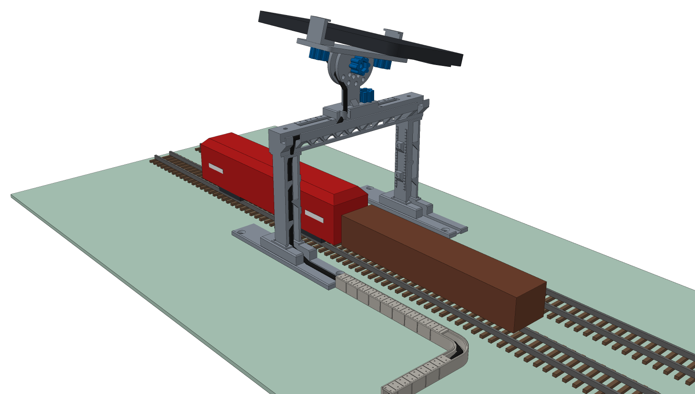
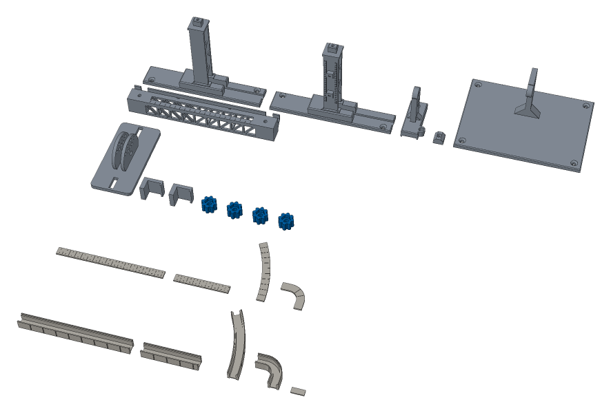
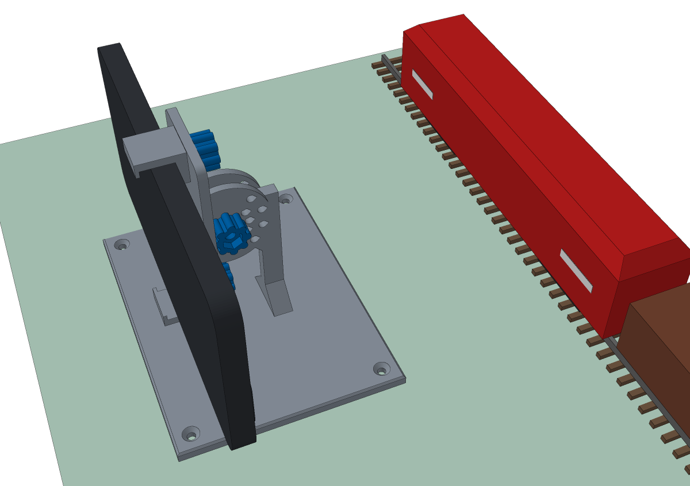

# Camera bridge: filming the lab's trains

A 3D-printed bridge over the tracks that holds a phone, a low stand beside the track for a second view, and cable troughs for the charging cable. It is for collecting images of the lab's trains to train a model that checks **train compositions**: which locomotive, read by its number, and which wagons in which order. The wagons carry no numbers, so the model has to tell them by their look.



*The bridge over two tracks 52 mm apart, the phone tilted 15° towards the near track. The charging cable comes along the cable troughs, runs up a column, along the girder's cable tray and up the mast.*

The model is inspired by the camera bridges (Kamerabrücken) of DB Cargo: portals over the tracks at its large marshalling yards, with high-speed cameras and lighting, that film every passing wagon. Since 2024 an AI reads the wagons' markings there and points out wear such as that of the brake blocks ([DB press release](https://www.deutschebahn.com/de/presse/pressestart_zentrales_uebersicht/Digitalisierung-im-Vorbeirollen-Bei-DB-Cargo-hilft-jetzt-die-KI-beim-Gueterwagen-Check-13046394), [Railway PRO](https://www.railwaypro.com/wp/db-cargo-now-uses-ai-to-help-with-freight-car-checks/)). The printed bridge is not a replica: it is a steel portal in H0 that carries a phone, with the look of cameras and light bars on its columns.

The parts are generated by [`hardware/camera-bridge/camera_bridge.py`](../hardware/camera-bridge/camera_bridge.py); ready STL files for the EBL are in [`hardware/camera-bridge/stl/`](../hardware/camera-bridge/stl/).

## The parts



| File | Print | What it is |
| --- | --- | --- |
| `column-a.stl`, `column-b.stl` | 1 each | A column (an H beam) on a concrete foundation and a 120 mm slab. The two are mirror images: the cable duct of both faces the same way. |
| `girder.stl` | 1 | The lattice girder: two trusses, a deck with a slot and a scale, a cable tray on brackets. |
| `mast.stl` | 1 | Clamps anywhere along the slot; carries the tilt axis and a clip for the cable. |
| `slot-nut.stl` | 1 | Sits under the deck and holds the head of the mast's bolt. |
| `cradle.stl` | 1 | The phone's cradle with the fork of the tilt axis. |
| `jaw.stl` | 2 | Hold the phone at its long edges. |
| `knob.stl` | 4 | Thumb knobs with a pressed-in M4 nut: two for the jaws, one for the mast, one for the axis. |
| `side-stand.stl` | 1, optional | Holds the same cradle low beside the track (see [Two views](#two-views-the-bridge-and-the-side-stand)). |
| `trough-straight.stl`, `trough-short.stl` | as needed | Cable troughs 100 and 50 mm long. |
| `trough-curve.stl`, `trough-bend.stl` | as needed | A curve (radius 120 mm, 30°) and a tight 90° bend. |
| `lid-*.stl` | one per trough | The lids, with the joints of 0.5 m concrete slabs. |
| `connector.stl` | one per joint | A small plate under the joint of two troughs, or of a trough and a column's slab, that keeps them in line. |

### Printing

- PLA or PETG, a 0.4 mm nozzle, 0.2 mm layers, 20 to 30 % infill. No part needs supports: the holes lying sideways have a pointed roof, the overhangs are 45°, the bridges at most 14 mm.
- Print the parts as they lie in the STL files: the columns, girder, mast and side stand upright; the cradle upside down; the jaws on their side. The longest parts are 146 mm (the girder) and 120 mm (the columns and the side stand), so a 180 mm bed is enough.
- Print one knob first and press an M4 nut into it. If it is too tight or too loose, generate the parts again with another `--fit` (default 0.2 mm).
- Colours: a light grey for the steel parts, a warm grey for the troughs (concrete).

### Hardware

| Count | Part | Where |
| --- | --- | --- |
| 2 | M4×12 hex bolt (DIN 933) | the jaws: the head in the jaw's foot, a knob under the cradle |
| 2 | M4×20 hex bolt (DIN 933) | the mast: the head in the slot nut, a knob on top; the axis: a knob on the far finger |
| 4 | M4 hex nut (DIN 934) | one pressed into each knob |
| 1 | M3×16 screw and M3 nut | the lock pin of the tilt |
| 2 | M3×16 screw, optional | girder to columns, through the deck into the tenons |

Also a USB cable for the phone (at most 4 mm thick, about 2 m), removable mounting putty, and felt or foam pads for the jaws if you like.

### Assembly

1. Press an M4 nut into each knob, from the side of the hexagonal pocket.
2. Put the columns on either side of the tracks, their slabs along the track, the cable ducts (the side with the teeth) towards where the cable comes from. `column-a` and `column-b` stand opposite each other, their camera housings facing the tracks.
3. Put the girder on the columns' tenons, its cable tray on the same side as the ducts. For a bridge that stays, screw it on with two M3×16 screws through the holes in the deck.
4. Put the head of an M4×20 bolt into the slot nut's pocket. Push the nut up into the girder from below, between the trusses, under the place where the mast is to stand, and the bolt up through the slot.
5. Put the mast on the deck (its skirts over the deck's edges, the bolt through its hole) and screw a knob onto the bolt.
6. Put the head of an M4×12 bolt into each jaw's foot, the bolt down through the cradle's slot, a knob below. The ticks beside the slots mark the phone's width every 4 mm (the long ticks at 64, 72, 80 and 88 mm): set both jaws to the same tick, so the phone sits over the axis.
7. Put the cradle's fork over the mast's tongue, the M4×20 bolt through the axis and a knob on it. Choose the tilt with the M3 lock pin (below) and tighten the knob.
8. Lay the phone in, screen up, the camera at the end beyond the girder, and close the jaws. Keep the volume buttons out of the jaws: in many camera apps they take a photo or start a video.

The lock pin goes through one hole of the fork and the matching hole of the tongue. The inner arc of the fork gives 0° and ±30°, the outer arc ±15° and ±45°; the mast's upper hole belongs to the inner arc, the lower one to the outer arc.

## Placing it in the lab

The defaults fit the EBL: two parallel tracks 52 mm apart (4.5 m, as the loading tracks G14 to G16 of the Bf Neustadt layout), the columns' inner faces 30 mm from the outer tracks' centres. Put the bridge on straight track; in a curve the vehicles swing out.

- **Height**: the girder's underside is 85 mm above the table, 79 mm above the rails (6.9 m in the prototype, more than the 6.7 m of a road bridge over a railway). The lab's tallest vehicles, its double-deck coaches, stand 53 mm high.
- **Other tracks**: one track, three tracks or another spacing take a new set of parts, for example `python camera_bridge.py --tracks 1 --out stl-1` or `--tracks 3 --track-spacing 52`. `--report` prints what comes out: the span, the heights, the ranges, the stability. For three tracks the girder is 198 mm long: lay it diagonally on a 180 mm bed.
- **Standing firm**: each column stands on a 120 mm slab along the track, so the phone's middle may sit up to 80 mm off the centre, anywhere the jaws can hold it, and a finger has to press about 9 N on the end of the phone before the bridge tips. With short feet (44 mm) 1 N was enough, a light tap. For long sessions, put some mounting putty under the slabs, or screw them down through the countersunk holes if the table may take screws. `--foot-length` makes the slabs longer still.

## Two views: the bridge and the side stand

The bridge sees the trains **from above**: every vehicle by its roof and its outline, its length, the order of the train, and with the phone tilted, one side too. That is what tells the wagons apart and the order of the train.

The **numbers of the locomotives** are small: about 2 mm high in H0, on the sides of the cabs. From the bridge they are seen at a steep angle and squashed. The side stand holds the same cradle with the phone upright, its camera at the height of the numbers, and looks across at the side of the train, as the cameras on the sides of a real camera bridge read the wagons' markings.



*The side stand with the phone upright. Turn the phone so that its camera is at the lower edge: the lens is then about 28 mm above the rails, level with the numbers.*

How high a number of 2 mm comes out in the video (the main camera, 26 mm equivalent):

| View | Distance | 4K | 1080p |
| --- | --- | --- | --- |
| Bridge, the mast 52 mm beside the track, tilted at the near side | 134 mm | 11 px | 5 px |
| Bridge, the mast 78 mm beside the track | 143 mm | 16 px | 8 px |
| Side stand, 100 mm from the locomotive's side | 100 mm | 55 px | 28 px |
| Side stand, 150 mm from it | 150 mm | 37 px | 18 px |
| Side stand, 200 mm from it | 200 mm | 28 px | 14 px |

Characters need about 15 to 20 px to be read reliably. So read the numbers from the side stand, 100 to 200 mm from the track, and the composition from the bridge; with two phones, film both at once. On the side stand the phone looks level or down at the track, by 15°, 30° or 45° (its upper edge leaning towards the track); leaning the other way it would hit the stand.

The side stand has a foot of 120 × 90 mm; a push of about 3 N on the screen towards the track tips it. Start and stop recordings without touching the phone: with a Bluetooth remote shutter, a smartwatch or the camera app's timer, or fix the foot with putty.

## The cable

The charging cable runs as on a real railway, in cable troughs (Kabelkanal) along the track:

1. **Troughs** on the table, from the table's edge or a socket to a column: straight pieces, curves and the tight bend, with a connector plate under every joint. The last trough meets the end of the column's slab, where a connector plate fits too.
2. **Slab and duct**: from the trough, the cable runs in the slab's groove into the column's duct. Press it in behind the teeth in a gentle S: the teeth overlap, so it stays in.
3. **Tray**: at the top of the duct, the cable goes up through the notch in the girder's cable tray and along the tray.
4. **Mast**: from the tray up through the clip on the mast's base, then to the phone. Leave enough slack for the tilt.

The troughs are made for a cable up to 4 mm thick; for a thicker one, generate them with `--cable-d`. Lay the cable in before the lids. Instead of a cable to the wall, a power bank beside the track works as well.

## Recording for the model

- **Video**: 4K at 30 or 60 frames per second. Lock focus and exposure (in most camera apps: hold a finger on the image), turn off stabilisation, HDR and the automatic switch to the macro camera. On the bridge the train's roofs are only 100 to 140 mm from the lens; if the main camera cannot focus that close, use the ultra-wide camera (0.5×).
- **Light**: bright and even, from LED lamps without flicker (the bands of flickering lamps show in short exposures). Run the trains at shunting speed, or set a short exposure (1/500 s or less) in an app that allows it.
- **Fixed settings**: note the tilt, the mast's place on the scale (a tick every 5 mm, a triangle at each track's centre) and the side stand's distance, and keep them for a whole series. Images from the same viewpoint are easier to learn from.
- **Labels**: for every run, write down what passed. The wagons have no numbers, so they are named by their type, and a lab name where two of a type would otherwise be mixed up:

```json
{
  "run": "2026-11-20-03",
  "videos": ["bridge-03.mp4", "side-03.mp4"],
  "track": "G15",
  "direction": "+x",
  "bridge": { "mast_mm": -26, "tilt_deg": 15 },
  "side_stand": { "distance_mm": 150, "tilt_deg": 0 },
  "vehicles": [
    { "kind": "locomotive", "number": "218 123-4", "leading": "cab 1" },
    { "kind": "wagon", "type": "Eaos", "label": "Eaos-1" },
    { "kind": "wagon", "type": "Eaos", "label": "Eaos-2" },
    { "kind": "wagon", "type": "Sgns", "label": "Sgns-1" }
  ]
}
```

A model that learns only the look can check that the right types stand in the right order; two wagons that look alike stay interchangeable. If a check has to tell them apart, they need a mark, such as the AprilTag deck cards of the [container terminal](container-terminal.md#markers-on-rolling-stock). Tags can also make the labels themselves; take them off, or crop them out, in the images the model learns from, so that it does not learn the tags instead of the wagons.

## Parameters

`python camera_bridge.py --help` lists them all; `--report` shows what they give. The ones you are most likely to change:

| Parameter | Default | Meaning |
| --- | --- | --- |
| `--tracks` | 2 | Tracks under the bridge |
| `--track-spacing` | 52 | Centre to centre, mm |
| `--side-clear` | 30 | From the outer track's centre to a column's inner face, mm |
| `--clear-height` | 85 | Table to the girder's underside, mm |
| `--foot-length` | 120 | The columns' slabs along the track, mm |
| `--side-foot-length` | 120 | The side stand's foot along the track, mm |
| `--mast-height` | 38 | Deck to the tilt axis, mm |
| `--cable-d` | 4 | The cable's diameter, mm |
| `--phone-t-max` | 12.5 | The thickest phone, with its case, mm |
| `--fit` | 0.2 | Clearance of parts that fit into each other, mm |

The generator needs Python 3.10 or newer, `manifold3d` and `numpy`:

```bash
cd hardware/camera-bridge
pip install -r requirements.txt
python camera_bridge.py --out stl --report      # the STL files and the report
python camera_bridge.py --render previews       # PNG pictures of the parts and the scenes
```

`tests/python/test_camera_bridge.py` checks the parts: each one solid and on the bed, small enough for a 180 mm printer, the STL files up to date, the trains clear of the girder and the columns, a tilt every 15°, nothing colliding at any tilt with the narrowest and the widest phone, the parts fitting into each other, and the stability above.
