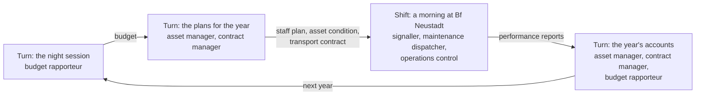

# The game core: one engine for every role

The railway is many people deciding at once, at very different rhythms: a signaller in seconds, a
dispatcher in minutes, an asset manager in budget years. [Games](games.md) describes the idea of a
game for every role and of the big game that joins them. This guide describes the engine under it
(`web/arail/game/`): what a role game is made of, how games are wired together by what the roles
give each other, how seconds and years are played in one session, how a mission is written as
data, and how a new role game is added.

- [In short](#in-short)
- [The concepts](#the-concepts)
- [A role game](#a-role-game): the class, its ports, its moves, its view, its computer player
- [Flows](#flows): what roles give each other
- [Turns and shifts](#turns-and-shifts): seconds and years in one game
- [A session](#a-session): seats, wiring, the bus, results
- [Missions as data](#missions-as-data)
- [Recorded and played again](#recorded-and-played-again): saving, the debrief, several devices
- [Modes and difficulty](#modes-and-difficulty)
- [The lab as a world](#the-lab-as-a-world): the EBL's simulation API
- [The role games so far](#the-role-games-so-far)
- [The parked games](#the-parked-games): infrastructure and rail operations on the engine
- [Writing a role game](#writing-a-role-game)
- [What comes next](#what-comes-next)

The issues behind it: #102 (a homogeneous, modular game architecture), #103 (the common game
core), #104 (game modes, time scales and difficulty), #105 (missions as data), #106 (multiplayer),
#124 (role-play-based games), #144 (the parked games).

## In short

- **A role game is a component with ports.** It declares the flows it *takes* from other roles and
  the flows it *gives* them: the signaller gives a fault report and takes the repair status; the
  maintenance dispatcher takes the fault report and gives the repair status.
- **Every input has three possible sources**: another role's game (the port is wired), the mission
  (a condition that holds, or an inject at a time), or the game itself (its defaults; its own
  repair team). So every game works alone, in 5 to 30 minutes, and joins the big game unchanged.
- **Slow roles play in turns, fast roles in shifts.** A session runs in phases, round after round:
  the budget, the year's plan (turns, no clock), a morning at Bf Neustadt (a shift, one clock for
  all fast roles), the year's account (a turn). A shift is a sample of its period: it shows how
  well the operators handle what the slow roles left them with.
- **State goes down, reports come up.** A turn's decisions reach the shift as state flows (the
  staff plan, the condition of the assets); what happened in the shift reaches the next turn as
  reports.
- **Missions are data.** A JSON document seats the roles, says who plays them (a person or the
  computer), names the phases and rounds, and what the mission itself gives. Its test run seats
  the computer everywhere.
- **Everything is deterministic and recorded.** The same seed and the same moves at the same ticks
  give the same session, so it can be saved, played again for the debrief, and shared between
  devices by exchanging moves only.
- **The world can be exchanged.** The operations of a shift are played by ARail's own games, or
  by the lab: the EBL's timetable simulation behind its HTTP API today, the lab itself later (see
  [The lab as a world](#the-lab-as-a-world)).

## The concepts

| Concept | What it is | In the code |
| --- | --- | --- |
| Role | A role of the role catalogue ([Roles](roles.md)), with its party and its rhythm | `web/game/roles/roles.json` |
| Party | The organisation or group a role belongs to (the infrastructure manager, a railway undertaking, a transport authority, …) | `PARTIES` in `flows.js`; a role's `party` |
| Game | One role at work: clock, resources, decisions, moves, rules, objectives, score | `class Game` in `core.js` |
| Flow | A thing one role gives another, as a type: an **event** (a fault report) or a **state** (a budget) | `FLOWS` in `flows.js` |
| Port | A game's declaration that it takes or gives a flow, and with which roles | `static takes`, `static gives` |
| Scale | The rhythm of a role's decisions: seconds, minutes, hours, days, months, years | `static scale`; `SCALES` |
| Seat | A role's place in a session: its game, played by a person or by the computer | `Session.seats` |
| Phase | A **turn** (slow roles decide, no clock) or a **shift** (fast roles work at the same time) | `mission.phases` |
| Round | The phases once through: a budget year, a contract month | `mission.rounds` |
| Mission | Seats, phases, rounds, what the mission gives, briefing and debrief, as data | `mission.js`, `web/game/missions/` |
| Session | A mission being played: the games, the flows on their way, the record | `class Session` in `session.js` |
| Record | The people's moves with their phase and tick | `Session.record`, `save()`, `replay()` |

## A role game

A game is a class that extends `Game` (`web/arail/game/core.js`). It runs without the world and
without the DOM, in Node and in the browser. What it declares:

| Static | Meaning | The maintenance dispatcher's |
| --- | --- | --- |
| `id`, `title` | The game | `"maintenance"`, "Fault Night" |
| `role` | The role of the catalogue it is the game of | `"maintenance-dispatcher"` |
| `kind` | `knowledge`, `simulation` or `both` | `"simulation"` |
| `scale` | The rhythm of its decisions | `"minutes"` |
| `takes` | The flows it takes, `{flow, from?}` | staff plan, asset condition, fault report, track closure |
| `gives` | The flows it gives, `{flow, to?}` | repair status, closure request, performance report |
| `actions` | The moves a player may make, by the name of their method | `send`, `callIn`, `decide` |
| `player` | The computer player for a seat nobody sits on | `MaintenancePlayer` |

What every game has, from the base class:

- a **clock** in simulated seconds (`t`), stepped from outside (`step(dt)`), with the game's own
  `tick`;
- **resources** (`resource`, `add`, `value`): money, time, staff, counters;
- **decisions** (`ask`, `open`): a title, options, a deadline and a fallback; without a decision by
  the deadline (in a turn: by its end) the fallback is taken;
- **moves** (`act(name, ...args)`): everything a player does goes through `act`, which checks the
  name against `static actions` and keeps the move (`moves`); a decision is the move `decide`;
- **rules** (`violate`): a rule broken, with its severity: 1 a slip, 2 a breach, 3 a danger to
  people;
- **objectives** with weights and the **score** (0–100); a round is passed with 50 points and no
  danger to people;
- **ports**: `give(flow, payload)` (only flows of `static gives`), `take(msg)` for what arrives,
  `conditions` (the latest of each state flow it takes) and `isWired(flow)` (is another seat at the
  other end?);
- **a view** (`view()`): key figures, tables, and the moves that can be made now, each with the
  fields to fill. The play page draws any game from it, as settings forms are drawn from a
  simulation's parameters; a game's own page (the signaller's panel) may draw more. A game can add
  a **sketch** to its view: a picture of its world as plain shapes (lines, dots, texts, tags, boxes
  in a `width` × `height`, coloured by a `tone`), which the play page draws as it is. A shape with
  an `id`, a `title` and a `menu` of moves can be chosen: the signaller's panel has its signals
  with their routes and its platform tracks to close, the dispatcher's district its faults with the
  teams to send and the vans on the road. The page still knows no game: it draws shapes and passes
  the move chosen to `act`;
- **the result** of a round (`result()`): what the career mode and the big game take from it.

A game that is not wired plays the other end of its ports itself. The signaller's game has its own
repair team that comes five minutes after the report; with a maintenance dispatcher seated, the
team is the dispatcher's and its steps arrive as flows:

```js
reportFault() {
  …
  this.give("fault-report", { fault: f.signal, asset: `Exit signal ${f.signal}`, place: STATION.name, track });
  if (this.team.remote) this.team.state = "called";               // the dispatcher sends the team
  else this.team = { state: "driving", at: this.t + TEAM_DRIVE_S }; // the game's own team
}

take(msg) {
  if (msg.flow === "repair-status" && msg.payload.state === "arrived") this._teamArrived();
  …
}
```

A **computer player** (`class Player`) makes a seat's moves: `think(game)` is called before every
tick of a shift and at the start of a turn, and moves through `game.act` like a person. The base
player takes every decision's fallback; each game names a better one (the signaller's sets the
routes as planned and gives Zs 1 with its checks; the dispatcher's sends the nearest free team to
the fault that matters most). Computer players play the roles nobody plays, and they are a
mission's test: a mission is winnable when the computer passes it.

## Flows

A flow is a thing with a name a railway person would use, not "information": a budget
(Haushaltsmittel), a train path (Trasse), a possession (Sperrpause), a fault report
(Störungsmeldung), a penalty (Pönale). `web/arail/game/flows.js` holds the catalogue: for each flow
its id, its name in English and German, its kind, its usual scale, its group, and one sentence on
what is handed over and what the receiver does with it.

- An **event** is a single message or handover that queues up at the receiver: a fault report, a
  work order, an invoice. The game gets it in `take(msg)`.
- A **state** is a standing arrangement that holds until it is replaced: a budget, a timetable, a
  contract, a staff plan. The receiver always works with the latest (`conditions[flow]`); a game
  that begins later begins with what holds then.

The role catalogue uses the same flows to say who gives what to whom: every one of its 176 roles
has its party, its scale and its `gives` (the flow, what exactly is handed over, and the roles it
goes to), and what a role takes follows from what the others give it (see [Roles](roles.md): about
2,900 flows from one role to another). The catalogue's graph is the wiring diagram of the whole
railway; a mission seats a part of it, and a game's ports are a part of its role's flows (a test
checks that a game gives and takes nothing its role does not in the catalogue). Where a game is
simpler than the railway, it says so: the undertaking's wish to hold a train goes to the
infrastructure manager's dispatcher, who orders the signaller; a mission without a dispatcher lets
the wish reach the signaller directly.

The flows of the first games and what they carry: the contract between the games.

| Flow | Kind | From → to | Payload |
| --- | --- | --- | --- |
| `budget` | state | budget committee MP → asset manager | `year`, `maintenance_eur`, `renewal_eur`, `blocked_eur`, `condition` |
| `staff-plan` | state | asset manager → maintenance dispatcher | `teams`, `on_call` |
| `asset-condition` | state | asset manager → signaller, maintenance dispatcher | `grade` (1 very good … 6 unusable), `faults_year`, `restrictions` |
| `transport-contract` | state | contract manager → operations control | `cancel_eur_km`, `late_eur`, `short_eur_km`, `late_from_min` |
| `fault-report` | event | signaller → maintenance dispatcher | `fault`, `asset`, `kind`, `place`, `track`, `holds` |
| `repair-status` | event | maintenance dispatcher → signaller | `fault`, `state` (dispatched, arrived, working, done), `eta_s`, `team` |
| `closure-request` | event | maintenance dispatcher → signaller | `fault`, `place`, `track`, `team` |
| `track-closure` | event | signaller → maintenance dispatcher | `place`, `track`, `closed`, `fault` |
| `delay-notice` | event | signaller, dispatcher → dispatcher, operations control | `train`, `kind`, `place`, `stage`, `delay_min`, `connection`, `cause` |
| `connection-request` | event | operations control → the dispatcher (without one seated: the signaller) | `hold`, `for`, `minutes` |
| `dispatching-order` | event | dispatcher → signaller | `hold`, `for`, `minutes` (a train to hold) |
| `passenger-information` | event | operations control → passengers | `train`, `text`, `delay_min` |
| `penalty`, `payment` | event | contract manager → undertaking | `year`, `eur`, `for` |
| `performance-report` | event | every game, at the end of its period | `scope`, `kind`, the period's numbers, `score` |

## Turns and shifts

The roles run on time scales six orders of magnitude apart. The engine does not simulate a year in
seconds, and it does not reduce a shift to a dice roll. It plays both, each at its own rhythm, in
**phases**:

- In a **turn** the slow roles (days to years) decide without a clock: the budget, the year's plan,
  the account. A game asks its decisions when the phase begins (`begin(ctx)`), people answer and
  make their moves, and when the turn is ended the decisions take effect (`finish(ctx)`): what is
  still open is decided by its fallback.
- In a **shift** the fast roles (seconds to hours) work at the same time on one clock, in fixed
  ticks of half a second. Each shift is a new game for its seats (one morning at Bf Neustadt),
  begun with what holds now.

A mission lays the phases out for a **round** (a budget year) and says how many rounds are played.
The round of the mission `neustadt-years`:



Two things couple the scales:

1. **State goes down.** What a turn decides reaches the shifts that follow as state flows: the
   asset manager's staff plan is the number of teams the maintenance dispatcher has; the condition
   of the assets decides whether the signal fails this morning and how many other faults the
   district brings.
2. **Reports come up.** At the end of a shift every game gives its account (`performance-report`):
   delays, connections, the minutes from a fault's report to its repair, overtime. The slow games
   read them in their review turn.

**A shift is a sample of its period**, not the period. It answers how well the operators handle an
event (how many minutes a failed signal cost with this signaller, this dispatcher and these
teams); the slow game's own model answers how often such events happen in a year (from the
condition of the assets). The year's delay minutes are the product: the faults of the year times
the minutes one fault cost in the sampled shift. Without a shift in the mission (a slow game played
alone), the slow game's model stands in for the operators too.

A slow game tells the phases apart by their id. By convention a phase with the id `review` is the
account of the period that just ended; in any other turn (`plan`, `budget`, …) the game asks this
period's decisions.

## A session

`Session` (`web/arail/game/session.js`) plays a mission:

- **Seats.** Each seat is a role's game with who plays it: `human` or `computer`. A seat can change
  hands while the session runs (`sit`): a person takes over a computer's seat, the computer takes
  over when somebody leaves. In a turn the computer then decides at once what is open, by its own
  rules, before the turn can end; in a shift it thinks with every tick.
- **Wiring.** A flow a game gives goes to every seated game that takes it, from that role if the
  port names roles. What no seat gives comes from the mission; what nobody takes, the game plays
  itself. `wiring(mission, games)` lists every port of every seat with what is at its other end:
  other seats, the mission, or the game itself.
- **The bus.** Flows travel at tick boundaries, in the order they were given: what a game gives in
  one tick, the others receive at the start of the next. A game that is not at work now (a slow
  role's game before its first turn, a fast role's between shifts) gets events as mail when its
  phase begins; a state is simply what holds then. Every flow delivered is kept (`session.flows`):
  the page shows them as "what the roles give each other", and the debrief reads them.
- **A tick** of a shift: the mission's injects that are due, the flows on their way, the computer
  players' moves, then every game's step. People move between ticks.
- **Results.** A shift's games give a result per round; a slow role's game at the end of each
  round. A seat's score is the mean of its rounds; the score of the whole is the seats' scores by
  their weights; the whole is passed when every seat passed all its rounds (a danger to people
  anywhere fails it).

```js
import { GAMES, play } from "../web/arail/game/index.js";

const session = play(mission, { seats: { "signaller-relay": "human" } }).start();
session.step(1);                                       // a shift goes on by a second
session.act("signaller-relay", "setRoute", "A-G2");    // a person's move
session.next();                                        // end a turn
session.result();                                      // seats, rounds, the score of the whole
```

## Missions as data

A mission is a JSON document (`web/game/missions/*.json`, listed in `missions.json`):

```json
{
 "format": "arail-mission/1",
 "id": "neustadt-morning",
 "title": "A morning at Bf Neustadt",
 "text": "08:00 to 08:40 at Bf Neustadt and in its district. …",
 "mode": "cooperative",
 "seed": 1,
 "roles": [
  { "role": "signaller-relay", "game": "signaller", "seat": "human", "level": "normal" },
  { "role": "maintenance-dispatcher", "game": "maintenance", "seat": "computer" }
 ],
 "rounds": 1,
 "phases": [
  { "id": "shift", "kind": "shift", "title": "The morning shift", "roles": ["signaller-relay", "maintenance-dispatcher"], "length": 2400, "clock": "08:00" }
 ],
 "conditions": { "staff-plan": { "teams": 2, "on_call": true } },
 "injects": [],
 "debrief": ["How long did the trains of track G2 wait, from the failure to the repair? …"]
}
```

| Field | Meaning |
| --- | --- |
| `roles[]` | The seats: `role` (catalogue id), `game` (the game's id), `seat` (`human` or `computer`, the suggestion; the players choose), `level`, `options` (passed to the game), `weight` (in the score of the whole), `id` (the role unless given; two seats of one role need ids) |
| `rounds` | How often the phases are played |
| `phases[]` | `id`, `kind` (`turn` or `shift`), `title`, `roles` (seat ids), for a shift `length` (s), `tick` (s, 0.5) and `clock` (its start, for the display); `rounds` (only in these rounds) |
| `conditions` | What holds and no seat gives: state flows by their id, with their payload |
| `injects[]` | What happens and no seat gives: `phase`, `at` (s into a shift), `flow`, `payload`, `to` (roles), `rounds` |
| `mode` | `solo`, `cooperative` (one score for all) or `competitive` (the parties' scores side by side) |
| `text`, `debrief[]` | The briefing, and questions for the debrief |

Without `phases`, a mission gets a plan turn, a shift and a review turn, as far as it has roles for
them. `validateMission(doc, games)` names what is wrong (a seat without a game of its role, a slow
role in a shift, a condition no seated game takes, …). `testRun(doc, games)` plays the mission
with the computer on every seat: a mission is sound when the run ends, and winnable when the
computer passes it. `tests/js/game-session.test.js` checks both for every mission of the site.

Difficulty is part of a mission: the level of each seat, the conditions (fewer teams, worn
assets), the injects (more disruptions), and which seats the computer plays.

## Recorded and played again

Games are deterministic: random numbers come from streams keyed by the seed and what they are for,
a shift runs in fixed ticks whatever the page's frame rate is, and flows travel in a fixed order.
A session records every move of a person with its phase and tick; the computer players need no
record, they decide the same again.

- `session.save()` gives `{format: "arail-session/1", mission, seed, seats, record, at}`.
- `Session.replay(mission, saved, {games})` rebuilds the session from it, up to where it stood, and
  it goes on from there.
- A game whose world is elsewhere and starts anew there cannot be rebuilt from a record: what was
  done in the lab at its time would all reach a new instance at once. Such a game says so
  (`static replays = false`), `Session.replayable(mission, games)` tells, `replay` refuses, and
  the play page neither keeps such a session nor offers to resume it.

This is the base of three things:

- **Saving and resuming** a session (the play page keeps the save in the browser).
- **The debrief** (#101): the session can be played again to any tick, the flows and the logs show
  who knew what when, and a move can be changed to see what would have happened.
- **Several devices** (#106). Because only the moves need to travel, devices in one room can play
  one session in lockstep: every device runs the same session and applies the same record. What
  is missing for that is a transport (a relay over the bridge's WebSocket) and a shared tick; the
  record's format is ready for it. An authoritative server (a headless Node process running the
  session, the devices as views) uses the same record and suits online play. The engine does not
  decide between the two; the choice (#106) can be made per mode.

## What led to what

A session's result says how each seat scored. It does not say why. In a shift with several roles,
the why lies between them: a signal was out of order for twenty minutes, and of these the
signaller took one to report it, the dispatcher eight to send a team (both teams were at other
faults), five went by on the road, two until the track was closed, four for a provisional repair,
which failed again. `Session.threads()` (`chain.js`) reads this from the flows alone:

- A flow that names a fault (`payload.fault`) is a step of that fault's **thread**: the fault
  report, the repair status (dispatched, arrived, diagnosed, working, done, secured, left,
  relapsed), the closure request, the track closed and opened.
- A track closure names a fault only when the track is the fault's own (the failed signal's
  track): a signaller who closes another track for another reason has not closed it for the
  repair. The chain takes a closure of another track for no step of the fault.
- Between two steps lies a **stretch** of time, and somebody or something was waited for: the
  reporter, the dispatcher (a team to send, the closure to ask for, the word on what to do), the
  signaller (the track to close, to open again), the road, the team's work. Each stretch has
  whose it was (a seat's id, `road`, `team`, or `others` for somebody who is not seated).
  While a repair held, the fault was not out of order.
- While a fault waited for a team, the thread says where the teams were (**meanwhile**): that is
  the price of the dispatcher's order of work, in the open.
- What the fault did in a game's own world, the game says in its account: a
  `performance-report` may carry `effects` (`{fault, text}`): "RB 33 left G2 on the substitute
  signal Zs 1, 1 min late", "held or slowed about 2 trains".

A game that wants its faults in the chain gives these flows with the fault's id; `since_s` on a
thread's first step says how long the fault stood before it (from the failure to its report, from
the report to the first team), and on the cause found how long the looking took. The play page
draws the threads on the result screen: every fault on the time line of the shift, each stretch in
the colour of whose it was, the minutes by whose they were, and what it did. This is what the
debrief starts from.

## Modes and difficulty

How the modes of #104 map onto the engine:

| Mode | In the engine |
| --- | --- |
| Sandbox | No game: the app and its Sandbox scenario |
| Mission | One session of one mission: a briefing, objectives, a result, a debrief |
| Campaign | Missions in a row with what is carried over: the career mode takes each round's `result()` (passed, a danger to people) as a step of a working life |
| Cooperative | `mode: "cooperative"`: the score of the whole counts |
| Competitive | `mode: "competitive"`: the parties' scores side by side (two undertakings on one network); the flows between them are the same |
| Lab mode | The operations of a shift are the lab's (see below); the other roles sit at tablets |
| Class mode | One device and a projector: people take the seats in turn (hot seat), the computer plays the rest |
| Public mode | A person alone: one seat, the computer plays the rest |

Time scales: a game says its scale; the session sorts it into turns or shifts. Difficulty: fewer
seats for people, harder levels, harder conditions, more injects, less information (a game decides
what its view shows).

## The lab as a world

The operations of a shift need not be ARail's own. The EBL's digital twin has a timetable
simulation with the train behaviour of the lab's driving simulator behind an HTTP API (`ebl`
repository, `5 Digitaler Zwilling/SIMULATION.md`): an instance runs one of the lab's timetables,
is stepped, and tells its trains, its events (departures, arrivals and passings with their delays,
routes that wait) and its results; and it takes **interventions**: hold a train, close a station
track, let a signal fail and repair it. It is the lab for now; the lab itself can stand behind the
same seat later.

For the engine the lab is **a seat** (`web/arail/game/lab.js`, the game `lab`): the
infrastructure manager's dispatcher of the lab's network, with the ports of a signaller's game, so
the other roles' games need not know whether ARail's small station or the lab is at the other end.

| In the lab | As a flow |
| --- | --- |
| A train departs or passes Neustadt a minute or more late | `delay-notice` |
| The signal that fails (scripted by the mission), reported at the seat | `fault-report` to the maintenance dispatcher |
| The station track closed or opened at the seat | `track-closure` |

| A flow to the seat | As an intervention in the lab |
| --- | --- |
| `connection-request`, or the move *Hold a train* | `hold` the train at the station until a time |
| `closure-request`, granted at the seat | `closeTrack`: no route is set into the track; trains due there are sent to another |
| `repair-status` done | `repairSignal`; then `openTrack` at the seat |

A game whose world is elsewhere cannot answer within a tick. It has an asynchronous `sync()`: it
creates the lab's instance (the timetable, the shift's window, the failure scripted at its time),
sends the interventions that are waiting, advances the lab to the game's time and reads its events.
A page calls `session.sync()` between its steps, and the session's clock waits (`holding`) while
the lab is more than 30 s behind; `session.runWith()` plays a session of computers this way. The
end of a shift waits too: when its time is up, the session takes no more ticks and moves, and
closes the shift only after the exchange that brought the lab up to the shift's end and sent the
last interventions, so that the account has the shift's last trains. A game that is left
(`leave()`: its shift is over, or the session is given up) gives back what it holds elsewhere:
the lab seat deletes its instance, of which a key has only a few. A
seat says what it must be told first in `static settings` (the address and a key of the API): the
play page asks for them. A lab that does not answer is said so, and the shift goes on without it.

The mission `lab-morning` seats the lab's dispatcher and the maintenance dispatcher: at 08:13 exit
signal N2 of Neustadt fails in the lab, the report sends the dispatcher's team, the track is closed
for it, and its report repairs the signal in the simulation; the trains of the lab's Monday
timetable wait, are sent to other tracks and run late, as the simulation's train behaviour and
signal boxes make them. To play it, start the API on the same computer and give the seat its
address and a key:

```sh
cd "5 Digitaler Zwilling"                    # in a checkout of the ebl repository
python -m ebl_twin.sim apikey add arail      # prints the key once
python -m ebl_twin.sim api --keys api_keys.json --port 8095 --cors
```

What is left out: the session's record does not hold the lab's answers, so a session with a lab
seat is not played again from its record alone (the simulation is deterministic, so the same
interventions at the same times give the same lab; replaying them is the next step). In the real
lab the way back stays under the lecturer's control (#77): the same flows then go to the people at
the desks as requests, not to the layout.

## The role games so far

| Game | Role | Played in | Takes | Gives | Alone, it plays |
| --- | --- | --- | --- | --- | --- |
| `signaller` (Signaller at Bf Neustadt; also its own page `game/signaller/`) | Signaller in a relay interlocking | shifts (seconds) | asset condition, repair status, closure request, connection request | fault report, track closure, delay notice, performance report | its own repair team (five minutes to come, six to repair); its level decides whether the signal fails |
| `maintenance` (Fault Night) | Maintenance and fault dispatcher | shifts (minutes) | staff plan, asset condition, fault report, track closure | repair status, closure request, performance report | the signaller's fault (exit signal N2), and the signallers who close the tracks |
| `lab` (The lab's morning) | Train dispatcher, at the lab | shifts (minutes) | repair status, closure request, connection request | fault report, track closure, delay notice, performance report | the repair team (ten minutes to come, six to repair); the trains are always the lab's |
| `transport-control` (Transportleitung) | Dispatcher in the undertaking's operations control | shifts (minutes) | delay notice, transport contract | connection request, passenger information, performance report (undertaking) | the morning's late trains, and the infrastructure manager, who keeps a hold asked for |
| `asset-manager` (Budget Years) | Asset manager | turns (years) | budget, performance report (operations, maintenance) | staff plan, asset condition, performance report (infrastructure) | the year's money (the level's, cut after a missed target) and the operators (minutes per fault from the teams) |
| `contract` (Malus Month) | Transport authority's contract manager | turns (months) | performance report (undertaking, operations) | transport contract, penalty, payment, performance report (contract) | the operator: its incident list by the usual rates, its finances and its learning |
| `budget` (The Night Session) | Budget committee's rail rapporteur | turns (years) | performance report (infrastructure) | budget, funding decision | the district's year (each line spends what its projects can build with) |

Seated together:

- **`neustadt-morning`** (signaller, maintenance dispatcher; one shift): the signaller's fault
  report sends the dispatcher's team, the team's arrival asks the signaller for the closure of G2,
  the closure lets the team work, and its report repairs the signal: the half hour of the
  signaller's game with the repair time in another player's hands. A dispatcher who never sends a
  team leaves the signaller with the failure for the whole shift.
- **`neustadt-years`** (budget rapporteur, asset manager, contract manager, signaller, maintenance
  dispatcher, operations control; three years): the rapporteur's budget is the district's money;
  the asset manager's staff plan is the number of teams the dispatcher has that morning, and the
  condition of the assets decides whether the signal fails and how many other faults the district
  brings; the contract manager's penalty catalogue is what a late or cancelled train costs the
  undertaking's dispatcher, who asks for a connecting train to be held when a feeder is announced
  late; the morning's reports give the minutes one fault costs, which the asset manager's year
  multiplies by the faults of the year, and the undertaking's cancelled and late trains, which
  shape the contract's incident list; the district's account goes back to the rapporteur.
- **`lab-morning`** (the lab's dispatcher, maintenance dispatcher; one shift on the lab's
  timetable): see above.
- Alone: `fault-night`, `transportleitung`, `budget-years`, `malus-month`, `night-session`.

## The parked games

The infrastructure game and the rail operations (`web/arail/infra/`, `web/arail/ops/`, on the game
page) were built before the game core and are parked until it can take them (#144). The core now
has what they need. How their parts map:

| Their part | On the engine |
| --- | --- |
| Infrastructure: `engine.roles[role] = "student" \| "computer"` | A seat per role, played by a person or the computer |
| Infrastructure: `ask(q)` with `def` and `deadline`, the inbox per role | `Game.ask` with a fallback; in a turn the fallback is taken when the turn ends |
| Infrastructure: `act(name, ...args)` recorded in `actions`, `save()`, `replay()` | `Game.act` and the session's record |
| Infrastructure: `runTo(t, {pause: true})` to the next decision | A turn per budget year; `begin` runs the engine to the year's decisions, `finish` to its end |
| Infrastructure: `years[].score` | `objectives()` |
| Infrastructure: `hooks.event` (`fault`, `dispatch`, `fixed`) | Flows: `fault-report`, `repair-status`; the staff on shift as `staff-plan`, the mean grade as `asset-condition` |
| Operations: parties (authority, undertaking, ECM, workshop), the ledger of penalties | Seats of four roles; `penalty` and `payment` flows |
| Operations: fixed rules where a person would decide (wait or cancel, crew cover, workshop booking) | Decisions of the undertaking's dispatcher, crew planner and workshop planner: the engine's `hooks` are the seam (#23) |
| Operations: `inject`, stress tests | A mission's injects and conditions |

The step that remains is an adapter each: a `Game` that holds an engine, raises the engine's
decisions as its own and gives the engine's events as flows. The adapters must live outside
`web/arail/game/` (which imports only the framework's math), in a package that may import both. The
asset manager's game above is a compact model made to be wired; the infrastructure engine behind
the same ports would be its full form.

## Writing a role game

1. **Start from the catalogue.** The role's entry says what the game is: its `loop`, `win`,
   `knowledge`, and what it takes and gives in the big game. Cut it to 5–15 minutes.
2. **Declare the ports.** Which flows does the role take, which does it give, with which roles?
   Use flows of the catalogue (`flows.js`); a new flow is a new entry there, with its German term.
3. **Make it work alone.** For every flow it takes: what does the game do when nobody gives it
   (a default, an event of its own, a counterpart it plays itself)? `isWired(flow)` tells.
4. **Everything a player does is a move** in `static actions`, with plain arguments; decisions
   have a fallback, in a shift a deadline. A question stays open only while its occasion lasts:
   when the state it asked about has passed (the team has gone, the track is open), take it back
   (`withdraw`), or a person will answer it into a state it was not asked in.
5. **Rules have a severity.** What must never happen in this role is severity 3: the round fails
   whatever the score.
6. **Objectives are what the railway would value** (punctuality, safety, cost, passengers), with
   weights that add to 100 and a note in words and numbers.
7. **`view()`** gives the figures, the tables and the moves of now; the play page needs nothing
   else. Where the role works on a picture (a panel, a map, a timetable graph), give it as the
   view's `sketch`, with the moves of a thing in its menu: a person should act on the thing, not
   look it up in a list.
8. **Every choice gives something up.** A decision with a right answer is a quiz. Give the role
   less than it needs (teams, time, money), and let it decide before it knows (a cause that only
   shows on site, a repair that may not hold): then two players decide differently, and both have
   reasons. The dispatcher's game does this with trades, causes and provisional repairs.
9. **A computer player** that plays by simple rules, breaks none and passes nearly every shift,
   and that a person with judgment can beat; a mission needs it for
   the seats nobody takes and for its test run.
10. **`finish()` gives the account** of the period as a `performance-report`.
11. **Deterministic**: `this.rng("purpose", key)`, never `Math.random`; no clock of the computer.
12. Add the game to `games.js` and `index.js`, a mission that seats it (alone, and with the roles
    it exchanges flows with), tests (alone with its computer player on every level; a careless
    player; people who play at random, with what must hold whatever they do; that the choices
    matter; each flow it takes and gives; in a session), and its model on the architecture page. Give its faults and what they did as flows that name the fault, so
    that the result can say what led to what.
13. People in a game get bird names (see [CONTRIBUTING](../CONTRIBUTING.md)).

## What comes next

- The money between the games: the contract manager's penalties and payments are given, and no
  game takes them yet (the undertaking's managing director and its contract manager would); the
  performance regime between the infrastructure manager and the undertakings is only a number in
  the asset manager's year.
- The play page for several devices: a relay for the record (#106), a facilitator's view with the
  flows and the injects (#96), the debrief with a timeline (#101).
- A mission editor (#105): seats, phases, conditions and injects on a timeline; content packs.
- The parked games behind the same ports (#144), the next role games of the catalogue
  (#148–#155), each with a mission alone and a place in a mission with others.
- The career mode on sessions: each step of a career a round of the role's game (#146).
- The lab behind the lab's seat: the Zentralrechner's telegrams instead of the simulation's API
  (reading), and the way back under the lecturer's control (#77); more of the lab at the seat (the
  other stations, the lab's own signal failures, connections between its trains).
